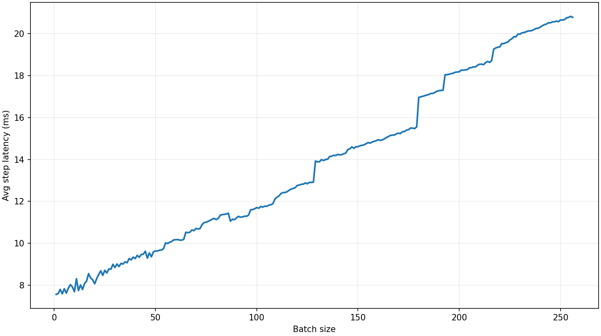
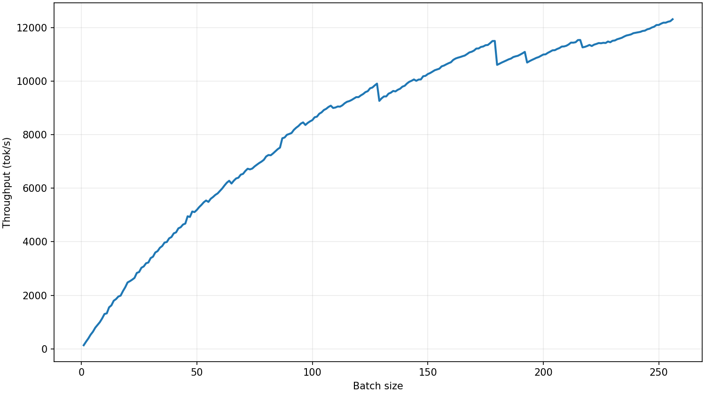
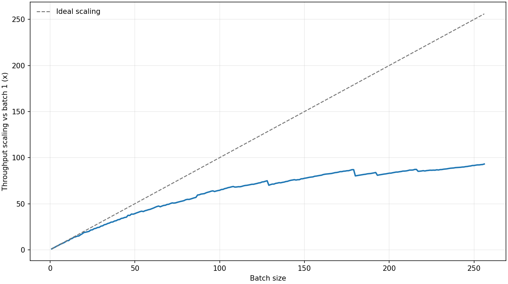

# Decode-Direct Input 512 TP=4 性能报告

## 运行环境

| 项目 | 值 |
| --- | --- |
| 日期 | 2026-11-18 15:32:36-15:41:01（Asia/Shanghai） |
| 平台 | NVIDIA |
| 设备 | 4 x A100-SXM4-80GB，默认 CUDA_VISIBLE_DEVICES=3,4,5,6 |
| Driver | 535.161.08 |
| InfiniLM build | 当前源码树；未记录独立 build ID |
| 模型 | `/data-aisoft/mechdancer/models/Qwen3-8B` |
| 模式 | `decode-direct` |
| Attention backend | `flash-attn` |
| Graph request | enabled |
| Expected execution mode | `graph` |
| Cache | paged KV cache，block size 256，num blocks 768 |
| Max batched tokens | 18432 |
| Tensor parallel size | 4 |
| Input length | 512 tokens / request |
| Batch size | 1..256 |
| Warmup | 每个形状 3 次 repeat |
| Measured repeats | 每个形状 30 次 repeat |
| Batch 执行顺序 | random seed 2026 |

本报告对应的原始 JSONL 和 log 为本机运行产物，不随仓库提交：

```text
../../../benchmark-decode-direct-qwen3-8b-flash-attn-tp4-input512-graph1-256-20261118.jsonl
../../../benchmark-decode-direct-qwen3-8b-flash-attn-tp4-input512-graph1-256-20261118.log
```

## 构建与测试命令

本轮使用当前已安装的 `_infinilm` 扩展。标准重建命令如下：

```bash
xmake build _infinilm && xmake install _infinilm
```

性能测试命令：

```bash
BENCHMARK_MODE=decode-direct \
BATCH_SIZES="$(seq -s, 1 256)" \
INPUT_LENS=512 \
BENCHMARK_REPEATS=30 \
BENCHMARK_OUTPUT=benchmark-decode-direct-qwen3-8b-flash-attn-tp4-input512-graph1-256-20261118.jsonl \
./run_bench-nvidia.sh
```

## 执行模式与 Graph 覆盖

当前 paged graph compiler 编译 decode batch size `1..256`。因此本轮所有 batch 均有对应 decode graph，无 eager fallback 混入；原始 JSONL 中所有 overall summary 的 `expected_execution_mode` 均为 `graph`。

## 资源开销

| 项目 | 值 |
| --- | ---: |
| Workspace allocation | 每 rank 702 MiB，TP=4 合计 2,808 MiB |
| 权重加载与 graph 编译时间 | 权重加载约 32.32 秒；graph 编译未单独记录 |
| Paged cache blocks | 768 |
| Compiled graph 数量 | 256 |
| 正式 step sample 数 | 30,720 |
| 本轮总耗时 | 约 505 秒 |

Input length 512 且执行 4 个 decode step 时，每个 request 需要 `3` 个 block；batch 256 共需要 `768` 个 block，本轮配置为 `768` 个 block。

## 测试口径

- `decode-direct` 不执行语义完整的 prefill，paged KV cache 初始为全 0。
- Step 0 输入 dummy token；step 1 到 step 3 使用上一步 sampled token。
- 4 个 decode step 的 past KV length 分别为 512、513、514、515。
- 报告中的 duration 是单 step 时间，由一次 4-step repeat 的对应总耗时除以 4 得到。
- `single_step_throughput = batch_size / avg_step_latency`。
- 每个 request 每 step 生成 1 个 token，因此 single-step request throughput 与 token throughput 数值相同。
- 表格中的 Min/P50/P95/P99/Max 是每个 repeat 的平均 step 时间分布。
- 计时边界为 `engine_forward_including_sampling`。

## 核心结果

| 指标 | 结果 |
| --- | ---: |
| 最高 single-step 吞吐 | batch 256，12,317.88 tok/s |
| 峰值 batch 平均单 step latency | 20.783 ms |
| 峰值 batch P99 单 step latency | 20.876 ms |
| batch 1 平均单 step latency | 7.557 ms |
| 峰值 batch 相对 batch 1 吞吐倍数 | 93.083x |
| 峰值 batch 相对理想 batch 倍数的效率 | 36.4% |
| 单 step std 中位数 | 0.036 ms |
| 最大单 step std | 0.139 ms，batch 36 |

## 趋势图

### 1. Batch size 与 Avg Step Latency



平均单 step latency 从 batch 1 的 7.557 ms 变为 batch 256 的 20.783 ms；峰值吞吐 batch 256 为 20.783 ms。

### 2. Batch size 与 Throughput



吞吐峰值出现在 batch 256，为 12,317.88 tok/s；最大 batch 256 为 12,317.88 tok/s。

### 3. Batch size 与 Scaling



Scaling 从 batch 1 的 1.000x 变为 batch 256 的 93.083x；相对理想 256x 的效率约为 36.4%。

## Batch 区间平均 latency 与吞吐

下表按连续 16 个 batch 分组；`平均单 step latency ms` 和 `平均吞吐 tok/s` 是区间内各 batch 的算术平均值，`区间最优 batch` 取区间内吞吐最高的 batch。

| Batch 区间 | 平均单 step latency ms | 平均吞吐 tok/s | 区间最优 batch |
| ---: | ---: | ---: | ---: |
| 1..16 | 7.849 | 1072.72 | 16 |
| 17..32 | 8.609 | 2834.70 | 32 |
| 33..48 | 9.299 | 4348.93 | 48 |
| 49..64 | 9.941 | 5676.46 | 64 |
| 65..80 | 10.834 | 6686.22 | 80 |
| 81..96 | 11.270 | 7853.39 | 96 |
| 97..112 | 11.857 | 8809.74 | 108 |
| 113..128 | 12.705 | 9481.55 | 128 |
| 129..144 | 14.099 | 9679.58 | 144 |
| 145..160 | 14.700 | 10371.90 | 160 |
| 161..176 | 15.195 | 11087.44 | 176 |
| 177..192 | 16.833 | 10968.91 | 179 |
| 193..208 | 18.221 | 11002.40 | 208 |
| 209..224 | 19.017 | 11385.35 | 216 |
| 225..240 | 20.049 | 11595.35 | 240 |
| 241..256 | 20.609 | 12057.05 | 256 |

## 关键批次与跳变

| 变化 | Avg step ms | 吞吐 tok/s | 观察 |
| --- | ---: | ---: | --- |
| 179 -> 180 | 15.557 -> 16.962 | 11506.04 -> 10612.21 | latency 增加 9.0%，可能对应 kernel shape 或 workspace 分档变化 |
| 10 -> 11 | 7.688 -> 8.306 | 1300.66 -> 1324.33 | latency 增加 8.0%，可能对应 kernel shape 或 workspace 分档变化 |
| 128 -> 129 | 12.914 -> 13.921 | 9911.51 -> 9266.38 | latency 增加 7.8%，可能对应 kernel shape 或 workspace 分档变化 |
| 16 -> 17 | 8.195 -> 8.550 | 1952.45 -> 1988.19 | latency 增加 4.3%，可能对应 kernel shape 或 workspace 分档变化 |
| 192 -> 193 | 17.301 -> 18.039 | 11097.38 -> 10698.81 | latency 增加 4.3%，可能对应 kernel shape 或 workspace 分档变化 |
| 14 -> 15 | 7.793 -> 8.075 | 1796.53 -> 1857.66 | latency 增加 3.6%，可能对应 kernel shape 或 workspace 分档变化 |

## Step 一致性

峰值 batch 256 的 4 个 decode step 结果如下：

| Step | Past KV length | Avg step ms | Std ms | Throughput tok/s |
| ---: | ---: | ---: | ---: | ---: |
| 0 | 512 | 20.760 | 0.032 | 12331.46 |
| 1 | 513 | 20.786 | 0.040 | 12315.91 |
| 2 | 514 | 20.798 | 0.073 | 12309.04 |
| 3 | 515 | 20.787 | 0.044 | 12315.12 |

所有 batch 中，4 个 step 平均耗时最大差异为 0.115 ms，出现在 batch 136。该差异主要来自 past KV length 增长与不同 step 的 kernel 形状。

## 数据稳定性

- 单 step std 中位数为 0.036 ms。
- 最大 std 为 0.139 ms，出现在 batch 36。
- 所有 batch 内 4 个 step 的平均耗时差异不超过 0.115 ms，step 间一致性较好。
- P99 与 max 接近，整体尾部稳定；但每个 batch 只有 30 个 repeat，p99 仍是尾部参考值。

## Single-step 完整结果

### Batch 1..64

| Batch | Mode | Avg Step ms | Min Step ms | P50 Step ms | P95 Step ms | P99 Step ms | Max Step ms | Std Step ms | Single-step tok/s | Scaling |
| ---: | --- | ---: | ---: | ---: | ---: | ---: | ---: | ---: | ---: | ---: |
| 1 | graph | 7.557 | 7.537 | 7.558 | 7.574 | 7.582 | 7.584 | 0.011 | 132.33 | 1.000x |
| 2 | graph | 7.601 | 7.590 | 7.601 | 7.610 | 7.614 | 7.615 | 0.007 | 263.13 | 1.988x |
| 3 | graph | 7.796 | 7.769 | 7.797 | 7.820 | 7.826 | 7.829 | 0.015 | 384.79 | 2.908x |
| 4 | graph | 7.587 | 7.569 | 7.581 | 7.610 | 7.637 | 7.647 | 0.015 | 527.23 | 3.984x |
| 5 | graph | 7.827 | 7.813 | 7.824 | 7.846 | 7.857 | 7.861 | 0.012 | 638.81 | 4.827x |
| 6 | graph | 7.622 | 7.597 | 7.608 | 7.662 | 7.839 | 7.903 | 0.055 | 787.17 | 5.948x |
| 7 | graph | 7.854 | 7.810 | 7.850 | 7.883 | 7.887 | 7.889 | 0.017 | 891.25 | 6.735x |
| 8 | graph | 8.024 | 7.963 | 8.023 | 8.052 | 8.293 | 8.390 | 0.074 | 997.03 | 7.534x |
| 9 | graph | 7.917 | 7.896 | 7.915 | 7.938 | 7.966 | 7.976 | 0.016 | 1,136.77 | 8.590x |
| 10 | graph | 7.688 | 7.670 | 7.686 | 7.704 | 7.715 | 7.719 | 0.010 | 1,300.66 | 9.829x |
| 11 | graph | 8.306 | 8.281 | 8.297 | 8.329 | 8.496 | 8.563 | 0.049 | 1,324.33 | 10.008x |
| 12 | graph | 7.741 | 7.728 | 7.738 | 7.755 | 7.764 | 7.767 | 0.009 | 1,550.24 | 11.715x |
| 13 | graph | 8.009 | 7.993 | 8.006 | 8.039 | 8.043 | 8.043 | 0.014 | 1,623.12 | 12.265x |
| 14 | graph | 7.793 | 7.777 | 7.787 | 7.810 | 7.852 | 7.868 | 0.018 | 1,796.53 | 13.576x |
| 15 | graph | 8.075 | 8.055 | 8.072 | 8.097 | 8.103 | 8.104 | 0.012 | 1,857.66 | 14.038x |
| 16 | graph | 8.195 | 8.176 | 8.187 | 8.229 | 8.285 | 8.303 | 0.024 | 1,952.45 | 14.754x |
| 17 | graph | 8.550 | 8.493 | 8.540 | 8.556 | 8.821 | 8.927 | 0.071 | 1,988.19 | 15.024x |
| 18 | graph | 8.345 | 8.259 | 8.342 | 8.374 | 8.433 | 8.451 | 0.027 | 2,156.95 | 16.299x |
| 19 | graph | 8.254 | 8.212 | 8.255 | 8.273 | 8.279 | 8.280 | 0.013 | 2,301.87 | 17.395x |
| 20 | graph | 8.065 | 8.001 | 8.051 | 8.080 | 8.341 | 8.446 | 0.073 | 2,479.91 | 18.740x |
| 21 | graph | 8.311 | 8.291 | 8.310 | 8.333 | 8.338 | 8.338 | 0.012 | 2,526.83 | 19.094x |
| 22 | graph | 8.515 | 8.477 | 8.513 | 8.544 | 8.558 | 8.561 | 0.016 | 2,583.65 | 19.524x |
| 23 | graph | 8.682 | 8.617 | 8.675 | 8.703 | 8.834 | 8.886 | 0.042 | 2,649.02 | 20.018x |
| 24 | graph | 8.465 | 8.450 | 8.465 | 8.486 | 8.489 | 8.489 | 0.012 | 2,835.16 | 21.424x |
| 25 | graph | 8.708 | 8.674 | 8.703 | 8.734 | 8.765 | 8.778 | 0.020 | 2,870.93 | 21.695x |
| 26 | graph | 8.581 | 8.554 | 8.573 | 8.631 | 8.673 | 8.688 | 0.028 | 3,030.03 | 22.897x |
| 27 | graph | 8.771 | 8.734 | 8.763 | 8.792 | 8.958 | 9.023 | 0.049 | 3,078.16 | 23.261x |
| 28 | graph | 8.759 | 8.725 | 8.750 | 8.789 | 8.885 | 8.923 | 0.034 | 3,196.79 | 24.157x |
| 29 | graph | 8.992 | 8.964 | 8.991 | 9.017 | 9.043 | 9.052 | 0.018 | 3,225.02 | 24.370x |
| 30 | graph | 8.846 | 8.819 | 8.841 | 8.877 | 8.896 | 8.902 | 0.018 | 3,391.29 | 25.627x |
| 31 | graph | 9.007 | 8.981 | 9.006 | 9.032 | 9.040 | 9.043 | 0.013 | 3,441.73 | 26.008x |
| 32 | graph | 8.890 | 8.854 | 8.885 | 8.920 | 8.986 | 9.010 | 0.027 | 3,599.65 | 27.201x |
| 33 | graph | 9.039 | 9.008 | 9.031 | 9.069 | 9.170 | 9.210 | 0.035 | 3,650.74 | 27.588x |
| 34 | graph | 9.005 | 8.952 | 8.998 | 9.059 | 9.068 | 9.071 | 0.030 | 3,775.50 | 28.530x |
| 35 | graph | 9.112 | 9.072 | 9.110 | 9.172 | 9.179 | 9.179 | 0.030 | 3,840.94 | 29.025x |
| 36 | graph | 9.068 | 8.994 | 9.028 | 9.345 | 9.590 | 9.607 | 0.139 | 3,970.05 | 30.001x |
| 37 | graph | 9.269 | 9.249 | 9.267 | 9.285 | 9.285 | 9.285 | 0.011 | 3,991.82 | 30.165x |
| 38 | graph | 9.204 | 9.080 | 9.202 | 9.244 | 9.325 | 9.357 | 0.043 | 4,128.64 | 31.199x |
| 39 | graph | 9.336 | 9.295 | 9.331 | 9.396 | 9.400 | 9.401 | 0.029 | 4,177.18 | 31.566x |
| 40 | graph | 9.270 | 9.221 | 9.253 | 9.303 | 9.613 | 9.737 | 0.089 | 4,314.82 | 32.606x |
| 41 | graph | 9.421 | 9.370 | 9.410 | 9.496 | 9.530 | 9.541 | 0.040 | 4,351.97 | 32.887x |
| 42 | graph | 9.329 | 9.254 | 9.332 | 9.373 | 9.391 | 9.396 | 0.033 | 4,501.99 | 34.020x |
| 43 | graph | 9.464 | 9.420 | 9.465 | 9.514 | 9.522 | 9.522 | 0.026 | 4,543.71 | 34.335x |
| 44 | graph | 9.475 | 9.395 | 9.479 | 9.528 | 9.538 | 9.539 | 0.032 | 4,643.88 | 35.092x |
| 45 | graph | 9.616 | 9.526 | 9.619 | 9.686 | 9.726 | 9.737 | 0.047 | 4,679.66 | 35.363x |
| 46 | graph | 9.288 | 9.201 | 9.290 | 9.335 | 9.350 | 9.354 | 0.033 | 4,952.72 | 37.426x |
| 47 | graph | 9.537 | 9.472 | 9.523 | 9.579 | 9.863 | 9.973 | 0.085 | 4,928.40 | 37.242x |
| 48 | graph | 9.355 | 9.307 | 9.348 | 9.435 | 9.447 | 9.450 | 0.037 | 5,130.88 | 38.773x |
| 49 | graph | 9.588 | 9.522 | 9.588 | 9.651 | 9.681 | 9.691 | 0.037 | 5,110.53 | 38.619x |
| 50 | graph | 9.630 | 9.526 | 9.616 | 9.780 | 9.812 | 9.816 | 0.065 | 5,191.99 | 39.234x |
| 51 | graph | 9.631 | 9.553 | 9.633 | 9.676 | 9.680 | 9.681 | 0.028 | 5,295.63 | 40.017x |
| 52 | graph | 9.665 | 9.513 | 9.671 | 9.696 | 9.703 | 9.706 | 0.033 | 5,380.23 | 40.657x |
| 53 | graph | 9.676 | 9.632 | 9.675 | 9.724 | 9.728 | 9.728 | 0.024 | 5,477.27 | 41.390x |
| 54 | graph | 9.742 | 9.671 | 9.736 | 9.797 | 9.813 | 9.813 | 0.031 | 5,542.90 | 41.886x |
| 55 | graph | 10.018 | 9.953 | 10.006 | 10.057 | 10.288 | 10.381 | 0.071 | 5,490.21 | 41.488x |
| 56 | graph | 9.987 | 9.916 | 9.985 | 10.034 | 10.040 | 10.041 | 0.030 | 5,607.13 | 42.371x |
| 57 | graph | 10.047 | 9.982 | 10.041 | 10.088 | 10.116 | 10.127 | 0.035 | 5,673.24 | 42.871x |
| 58 | graph | 10.083 | 9.976 | 10.086 | 10.143 | 10.154 | 10.156 | 0.037 | 5,752.51 | 43.470x |
| 59 | graph | 10.159 | 10.084 | 10.153 | 10.213 | 10.225 | 10.226 | 0.033 | 5,807.62 | 43.886x |
| 60 | graph | 10.168 | 10.088 | 10.159 | 10.216 | 10.240 | 10.248 | 0.036 | 5,901.09 | 44.593x |
| 61 | graph | 10.175 | 10.064 | 10.177 | 10.210 | 10.211 | 10.212 | 0.032 | 5,994.85 | 45.301x |
| 62 | graph | 10.150 | 10.042 | 10.138 | 10.237 | 10.245 | 10.248 | 0.046 | 6,108.11 | 46.157x |
| 63 | graph | 10.145 | 10.081 | 10.135 | 10.231 | 10.278 | 10.290 | 0.047 | 6,210.13 | 46.928x |
| 64 | graph | 10.191 | 10.093 | 10.202 | 10.241 | 10.292 | 10.313 | 0.043 | 6,279.94 | 47.456x |

### Batch 65..128

| Batch | Mode | Avg Step ms | Min Step ms | P50 Step ms | P95 Step ms | P99 Step ms | Max Step ms | Std Step ms | Single-step tok/s | Scaling |
| ---: | --- | ---: | ---: | ---: | ---: | ---: | ---: | ---: | ---: | ---: |
| 65 | graph | 10.523 | 10.462 | 10.528 | 10.560 | 10.586 | 10.595 | 0.032 | 6,177.08 | 46.678x |
| 66 | graph | 10.504 | 10.427 | 10.491 | 10.580 | 10.782 | 10.863 | 0.078 | 6,283.07 | 47.479x |
| 67 | graph | 10.523 | 10.452 | 10.526 | 10.571 | 10.580 | 10.582 | 0.031 | 6,367.04 | 48.114x |
| 68 | graph | 10.633 | 10.537 | 10.628 | 10.688 | 10.773 | 10.806 | 0.052 | 6,395.00 | 48.325x |
| 69 | graph | 10.602 | 10.543 | 10.605 | 10.665 | 10.671 | 10.671 | 0.035 | 6,508.01 | 49.179x |
| 70 | graph | 10.705 | 10.563 | 10.701 | 10.793 | 11.002 | 11.087 | 0.092 | 6,538.83 | 49.412x |
| 71 | graph | 10.682 | 10.563 | 10.700 | 10.745 | 10.749 | 10.750 | 0.056 | 6,646.96 | 50.229x |
| 72 | graph | 10.698 | 10.634 | 10.703 | 10.756 | 10.763 | 10.765 | 0.035 | 6,730.09 | 50.857x |
| 73 | graph | 10.886 | 10.759 | 10.896 | 10.949 | 10.955 | 10.956 | 0.049 | 6,705.86 | 50.674x |
| 74 | graph | 10.984 | 10.817 | 10.983 | 11.042 | 11.043 | 11.043 | 0.046 | 6,737.23 | 50.911x |
| 75 | graph | 11.003 | 10.834 | 11.014 | 11.065 | 11.090 | 11.100 | 0.058 | 6,816.33 | 51.509x |
| 76 | graph | 11.044 | 10.966 | 11.046 | 11.090 | 11.111 | 11.117 | 0.034 | 6,881.46 | 52.001x |
| 77 | graph | 11.089 | 10.887 | 11.095 | 11.146 | 11.241 | 11.277 | 0.061 | 6,943.68 | 52.471x |
| 78 | graph | 11.148 | 10.959 | 11.138 | 11.277 | 11.390 | 11.424 | 0.087 | 6,996.94 | 52.874x |
| 79 | graph | 11.184 | 11.067 | 11.173 | 11.256 | 11.297 | 11.313 | 0.053 | 7,063.70 | 53.378x |
| 80 | graph | 11.129 | 10.938 | 11.132 | 11.202 | 11.220 | 11.224 | 0.053 | 7,188.30 | 54.320x |
| 81 | graph | 11.184 | 11.114 | 11.180 | 11.242 | 11.251 | 11.251 | 0.038 | 7,242.64 | 54.730x |
| 82 | graph | 11.336 | 11.277 | 11.327 | 11.374 | 11.516 | 11.573 | 0.051 | 7,233.54 | 54.662x |
| 83 | graph | 11.366 | 11.265 | 11.365 | 11.451 | 11.523 | 11.538 | 0.052 | 7,302.59 | 55.183x |
| 84 | graph | 11.377 | 11.293 | 11.370 | 11.429 | 11.490 | 11.515 | 0.043 | 7,383.11 | 55.792x |
| 85 | graph | 11.392 | 11.301 | 11.387 | 11.464 | 11.471 | 11.473 | 0.041 | 7,461.17 | 56.382x |
| 86 | graph | 11.434 | 11.362 | 11.441 | 11.495 | 11.502 | 11.504 | 0.033 | 7,521.11 | 56.835x |
| 87 | graph | 11.056 | 10.935 | 11.048 | 11.148 | 11.182 | 11.195 | 0.060 | 7,868.99 | 59.464x |
| 88 | graph | 11.142 | 11.049 | 11.145 | 11.216 | 11.230 | 11.235 | 0.047 | 7,897.71 | 59.681x |
| 89 | graph | 11.127 | 10.976 | 11.116 | 11.195 | 11.420 | 11.511 | 0.090 | 7,998.55 | 60.443x |
| 90 | graph | 11.208 | 11.142 | 11.208 | 11.244 | 11.318 | 11.348 | 0.038 | 8,029.93 | 60.680x |
| 91 | graph | 11.282 | 11.176 | 11.276 | 11.380 | 11.413 | 11.420 | 0.061 | 8,065.74 | 60.950x |
| 92 | graph | 11.243 | 11.173 | 11.240 | 11.294 | 11.301 | 11.304 | 0.032 | 8,182.52 | 61.833x |
| 93 | graph | 11.256 | 10.969 | 11.268 | 11.309 | 11.314 | 11.316 | 0.060 | 8,262.41 | 62.437x |
| 94 | graph | 11.289 | 11.182 | 11.275 | 11.362 | 11.476 | 11.521 | 0.064 | 8,327.04 | 62.925x |
| 95 | graph | 11.289 | 11.205 | 11.279 | 11.380 | 11.444 | 11.460 | 0.048 | 8,414.90 | 63.589x |
| 96 | graph | 11.344 | 11.127 | 11.351 | 11.439 | 11.440 | 11.440 | 0.078 | 8,462.30 | 63.947x |
| 97 | graph | 11.595 | 11.546 | 11.590 | 11.644 | 11.649 | 11.650 | 0.030 | 8,365.84 | 63.218x |
| 98 | graph | 11.608 | 11.542 | 11.604 | 11.673 | 11.723 | 11.740 | 0.042 | 8,442.41 | 63.797x |
| 99 | graph | 11.646 | 11.569 | 11.644 | 11.698 | 11.707 | 11.709 | 0.035 | 8,500.74 | 64.238x |
| 100 | graph | 11.701 | 11.610 | 11.685 | 11.811 | 12.045 | 12.126 | 0.094 | 8,546.30 | 64.582x |
| 101 | graph | 11.671 | 11.611 | 11.669 | 11.726 | 11.751 | 11.758 | 0.034 | 8,653.65 | 65.393x |
| 102 | graph | 11.756 | 11.659 | 11.747 | 11.808 | 11.870 | 11.895 | 0.046 | 8,676.71 | 65.567x |
| 103 | graph | 11.724 | 11.656 | 11.714 | 11.768 | 12.010 | 12.106 | 0.077 | 8,785.70 | 66.391x |
| 104 | graph | 11.768 | 11.685 | 11.761 | 11.857 | 11.861 | 11.862 | 0.046 | 8,837.16 | 66.780x |
| 105 | graph | 11.765 | 11.680 | 11.767 | 11.818 | 11.819 | 11.819 | 0.035 | 8,924.89 | 67.443x |
| 106 | graph | 11.818 | 11.738 | 11.822 | 11.881 | 11.893 | 11.896 | 0.040 | 8,969.32 | 67.778x |
| 107 | graph | 11.837 | 11.706 | 11.848 | 11.905 | 11.926 | 11.928 | 0.049 | 9,039.19 | 68.306x |
| 108 | graph | 11.885 | 11.835 | 11.881 | 11.927 | 11.959 | 11.969 | 0.028 | 9,087.15 | 68.669x |
| 109 | graph | 12.110 | 12.056 | 12.105 | 12.161 | 12.255 | 12.287 | 0.041 | 9,000.91 | 68.017x |
| 110 | graph | 12.197 | 12.134 | 12.186 | 12.246 | 12.438 | 12.517 | 0.066 | 9,018.49 | 68.150x |
| 111 | graph | 12.257 | 12.189 | 12.249 | 12.342 | 12.363 | 12.364 | 0.043 | 9,056.28 | 68.436x |
| 112 | graph | 12.374 | 12.280 | 12.349 | 12.418 | 12.894 | 13.084 | 0.136 | 9,051.14 | 68.397x |
| 113 | graph | 12.417 | 12.364 | 12.416 | 12.449 | 12.465 | 12.471 | 0.021 | 9,100.78 | 68.772x |
| 114 | graph | 12.422 | 12.376 | 12.424 | 12.455 | 12.467 | 12.469 | 0.020 | 9,177.09 | 69.349x |
| 115 | graph | 12.457 | 12.419 | 12.450 | 12.495 | 12.583 | 12.619 | 0.037 | 9,232.06 | 69.764x |
| 116 | graph | 12.530 | 12.459 | 12.528 | 12.602 | 12.663 | 12.677 | 0.043 | 9,257.98 | 69.960x |
| 117 | graph | 12.581 | 12.527 | 12.570 | 12.693 | 12.742 | 12.751 | 0.049 | 9,299.69 | 70.275x |
| 118 | graph | 12.616 | 12.543 | 12.615 | 12.677 | 12.693 | 12.698 | 0.038 | 9,352.86 | 70.677x |
| 119 | graph | 12.651 | 12.587 | 12.646 | 12.737 | 12.761 | 12.764 | 0.044 | 9,406.70 | 71.084x |
| 120 | graph | 12.758 | 12.709 | 12.749 | 12.832 | 12.893 | 12.917 | 0.042 | 9,405.91 | 71.078x |
| 121 | graph | 12.776 | 12.727 | 12.771 | 12.850 | 12.897 | 12.902 | 0.039 | 9,471.19 | 71.571x |
| 122 | graph | 12.812 | 12.757 | 12.804 | 12.879 | 12.890 | 12.891 | 0.035 | 9,522.16 | 71.956x |
| 123 | graph | 12.821 | 12.771 | 12.815 | 12.880 | 12.886 | 12.887 | 0.031 | 9,593.98 | 72.499x |
| 124 | graph | 12.878 | 12.798 | 12.882 | 12.921 | 12.937 | 12.943 | 0.035 | 9,628.86 | 72.762x |
| 125 | graph | 12.838 | 12.800 | 12.834 | 12.875 | 12.896 | 12.903 | 0.022 | 9,736.50 | 73.576x |
| 126 | graph | 12.903 | 12.838 | 12.893 | 12.983 | 13.011 | 13.022 | 0.047 | 9,765.01 | 73.791x |
| 127 | graph | 12.903 | 12.834 | 12.887 | 13.057 | 13.195 | 13.218 | 0.079 | 9,842.59 | 74.377x |
| 128 | graph | 12.914 | 12.862 | 12.925 | 12.943 | 12.949 | 12.951 | 0.026 | 9,911.51 | 74.898x |

### Batch 129..192

| Batch | Mode | Avg Step ms | Min Step ms | P50 Step ms | P95 Step ms | P99 Step ms | Max Step ms | Std Step ms | Single-step tok/s | Scaling |
| ---: | --- | ---: | ---: | ---: | ---: | ---: | ---: | ---: | ---: | ---: |
| 129 | graph | 13.921 | 13.871 | 13.917 | 13.979 | 13.989 | 13.989 | 0.031 | 9,266.38 | 70.023x |
| 130 | graph | 13.887 | 13.845 | 13.879 | 13.961 | 13.978 | 13.984 | 0.036 | 9,361.29 | 70.740x |
| 131 | graph | 13.889 | 13.796 | 13.881 | 13.971 | 13.990 | 13.990 | 0.043 | 9,431.90 | 71.274x |
| 132 | graph | 13.993 | 13.899 | 13.992 | 14.086 | 14.094 | 14.095 | 0.047 | 9,433.25 | 71.284x |
| 133 | graph | 13.947 | 13.879 | 13.940 | 14.016 | 14.030 | 14.035 | 0.039 | 9,535.81 | 72.059x |
| 134 | graph | 13.998 | 13.955 | 13.996 | 14.031 | 14.037 | 14.040 | 0.023 | 9,573.04 | 72.341x |
| 135 | graph | 14.008 | 13.841 | 14.013 | 14.078 | 14.109 | 14.120 | 0.053 | 9,637.13 | 72.825x |
| 136 | graph | 14.137 | 14.041 | 14.106 | 14.340 | 14.539 | 14.619 | 0.117 | 9,620.26 | 72.697x |
| 137 | graph | 14.152 | 14.092 | 14.122 | 14.197 | 14.603 | 14.766 | 0.118 | 9,680.57 | 73.153x |
| 138 | graph | 14.197 | 14.151 | 14.190 | 14.254 | 14.270 | 14.274 | 0.030 | 9,720.18 | 73.453x |
| 139 | graph | 14.187 | 14.128 | 14.172 | 14.279 | 14.298 | 14.305 | 0.043 | 9,797.64 | 74.038x |
| 140 | graph | 14.241 | 14.182 | 14.228 | 14.313 | 14.315 | 14.315 | 0.040 | 9,830.68 | 74.287x |
| 141 | graph | 14.217 | 14.172 | 14.215 | 14.261 | 14.277 | 14.280 | 0.026 | 9,917.52 | 74.944x |
| 142 | graph | 14.227 | 14.161 | 14.222 | 14.301 | 14.432 | 14.475 | 0.058 | 9,980.92 | 75.423x |
| 143 | graph | 14.272 | 14.192 | 14.269 | 14.327 | 14.355 | 14.367 | 0.038 | 10,019.27 | 75.713x |
| 144 | graph | 14.303 | 14.240 | 14.299 | 14.371 | 14.386 | 14.388 | 0.034 | 10,067.48 | 76.077x |
| 145 | graph | 14.477 | 14.447 | 14.472 | 14.515 | 14.550 | 14.562 | 0.024 | 10,016.01 | 75.688x |
| 146 | graph | 14.508 | 14.442 | 14.503 | 14.566 | 14.638 | 14.664 | 0.041 | 10,063.11 | 76.044x |
| 147 | graph | 14.600 | 14.539 | 14.601 | 14.629 | 14.637 | 14.639 | 0.023 | 10,068.60 | 76.085x |
| 148 | graph | 14.528 | 14.475 | 14.525 | 14.573 | 14.595 | 14.599 | 0.025 | 10,186.98 | 76.980x |
| 149 | graph | 14.605 | 14.535 | 14.586 | 14.672 | 14.994 | 15.110 | 0.099 | 10,201.89 | 77.093x |
| 150 | graph | 14.607 | 14.549 | 14.607 | 14.655 | 14.739 | 14.770 | 0.042 | 10,269.13 | 77.601x |
| 151 | graph | 14.651 | 14.579 | 14.649 | 14.707 | 14.742 | 14.756 | 0.035 | 10,306.55 | 77.884x |
| 152 | graph | 14.675 | 14.601 | 14.660 | 14.819 | 14.840 | 14.846 | 0.059 | 10,357.75 | 78.270x |
| 153 | graph | 14.695 | 14.640 | 14.684 | 14.768 | 14.821 | 14.840 | 0.042 | 10,411.50 | 78.677x |
| 154 | graph | 14.750 | 14.685 | 14.748 | 14.792 | 14.808 | 14.813 | 0.027 | 10,440.63 | 78.897x |
| 155 | graph | 14.804 | 14.709 | 14.772 | 15.000 | 15.158 | 15.214 | 0.103 | 10,469.94 | 79.118x |
| 156 | graph | 14.777 | 14.720 | 14.768 | 14.828 | 14.908 | 14.937 | 0.040 | 10,557.12 | 79.777x |
| 157 | graph | 14.831 | 14.772 | 14.824 | 14.897 | 14.903 | 14.905 | 0.039 | 10,586.03 | 79.995x |
| 158 | graph | 14.861 | 14.790 | 14.865 | 14.909 | 14.935 | 14.943 | 0.034 | 10,631.86 | 80.342x |
| 159 | graph | 14.896 | 14.821 | 14.880 | 14.937 | 15.159 | 15.247 | 0.072 | 10,674.22 | 80.662x |
| 160 | graph | 14.941 | 14.841 | 14.918 | 15.037 | 15.349 | 15.469 | 0.109 | 10,709.15 | 80.926x |
| 161 | graph | 14.911 | 14.763 | 14.903 | 14.997 | 15.022 | 15.028 | 0.046 | 10,797.65 | 81.595x |
| 162 | graph | 14.933 | 14.879 | 14.927 | 15.012 | 15.039 | 15.041 | 0.038 | 10,848.40 | 81.978x |
| 163 | graph | 14.982 | 14.924 | 14.979 | 15.032 | 15.036 | 15.037 | 0.030 | 10,879.80 | 82.215x |
| 164 | graph | 15.040 | 14.982 | 15.037 | 15.081 | 15.097 | 15.102 | 0.027 | 10,903.93 | 82.398x |
| 165 | graph | 15.091 | 15.006 | 15.074 | 15.207 | 15.332 | 15.381 | 0.074 | 10,933.57 | 82.622x |
| 166 | graph | 15.146 | 15.015 | 15.152 | 15.217 | 15.226 | 15.228 | 0.046 | 10,960.27 | 82.823x |
| 167 | graph | 15.160 | 15.075 | 15.166 | 15.201 | 15.212 | 15.215 | 0.034 | 11,016.14 | 83.246x |
| 168 | graph | 15.166 | 15.096 | 15.148 | 15.311 | 15.443 | 15.467 | 0.077 | 11,077.61 | 83.710x |
| 169 | graph | 15.222 | 15.156 | 15.215 | 15.322 | 15.351 | 15.360 | 0.047 | 11,102.65 | 83.899x |
| 170 | graph | 15.250 | 15.156 | 15.245 | 15.316 | 15.387 | 15.415 | 0.045 | 11,147.20 | 84.236x |
| 171 | graph | 15.238 | 15.146 | 15.252 | 15.308 | 15.319 | 15.320 | 0.051 | 11,221.90 | 84.801x |
| 172 | graph | 15.322 | 15.269 | 15.315 | 15.420 | 15.474 | 15.476 | 0.047 | 11,225.35 | 84.827x |
| 173 | graph | 15.335 | 15.272 | 15.327 | 15.377 | 15.383 | 15.385 | 0.029 | 11,281.73 | 85.253x |
| 174 | graph | 15.398 | 15.333 | 15.387 | 15.453 | 15.497 | 15.515 | 0.038 | 11,299.89 | 85.390x |
| 175 | graph | 15.422 | 15.361 | 15.408 | 15.466 | 15.720 | 15.823 | 0.080 | 11,347.19 | 85.747x |
| 176 | graph | 15.499 | 15.418 | 15.476 | 15.657 | 15.723 | 15.724 | 0.074 | 11,355.74 | 85.812x |
| 177 | graph | 15.491 | 15.433 | 15.492 | 15.533 | 15.550 | 15.556 | 0.030 | 11,425.80 | 86.341x |
| 178 | graph | 15.474 | 15.360 | 15.477 | 15.523 | 15.526 | 15.527 | 0.038 | 11,503.47 | 86.928x |
| 179 | graph | 15.557 | 15.498 | 15.543 | 15.658 | 15.771 | 15.798 | 0.059 | 11,506.04 | 86.948x |
| 180 | graph | 16.962 | 16.894 | 16.939 | 17.033 | 17.308 | 17.414 | 0.091 | 10,612.21 | 80.193x |
| 181 | graph | 16.989 | 16.924 | 16.990 | 17.023 | 17.036 | 17.041 | 0.026 | 10,653.71 | 80.507x |
| 182 | graph | 17.012 | 16.970 | 17.011 | 17.050 | 17.057 | 17.060 | 0.023 | 10,698.10 | 80.842x |
| 183 | graph | 17.044 | 16.994 | 17.037 | 17.101 | 17.145 | 17.163 | 0.035 | 10,736.86 | 81.135x |
| 184 | graph | 17.074 | 17.016 | 17.073 | 17.111 | 17.118 | 17.120 | 0.023 | 10,776.77 | 81.437x |
| 185 | graph | 17.100 | 17.006 | 17.108 | 17.156 | 17.184 | 17.193 | 0.044 | 10,818.50 | 81.752x |
| 186 | graph | 17.147 | 17.092 | 17.147 | 17.184 | 17.202 | 17.209 | 0.026 | 10,847.37 | 81.970x |
| 187 | graph | 17.150 | 17.089 | 17.155 | 17.195 | 17.204 | 17.205 | 0.033 | 10,903.74 | 82.396x |
| 188 | graph | 17.199 | 17.161 | 17.194 | 17.242 | 17.262 | 17.268 | 0.023 | 10,930.77 | 82.601x |
| 189 | graph | 17.258 | 17.208 | 17.244 | 17.350 | 17.463 | 17.489 | 0.056 | 10,951.59 | 82.758x |
| 190 | graph | 17.279 | 17.243 | 17.273 | 17.333 | 17.366 | 17.376 | 0.030 | 10,995.85 | 83.092x |
| 191 | graph | 17.294 | 17.254 | 17.292 | 17.334 | 17.370 | 17.383 | 0.028 | 11,044.41 | 83.459x |
| 192 | graph | 17.301 | 17.252 | 17.295 | 17.344 | 17.388 | 17.405 | 0.029 | 11,097.38 | 83.860x |

### Batch 193..256

| Batch | Mode | Avg Step ms | Min Step ms | P50 Step ms | P95 Step ms | P99 Step ms | Max Step ms | Std Step ms | Single-step tok/s | Scaling |
| ---: | --- | ---: | ---: | ---: | ---: | ---: | ---: | ---: | ---: | ---: |
| 193 | graph | 18.039 | 17.987 | 18.038 | 18.066 | 18.068 | 18.068 | 0.018 | 10,698.81 | 80.848x |
| 194 | graph | 18.048 | 18.002 | 18.046 | 18.081 | 18.087 | 18.089 | 0.020 | 10,749.29 | 81.229x |
| 195 | graph | 18.067 | 18.002 | 18.071 | 18.094 | 18.114 | 18.122 | 0.024 | 10,793.32 | 81.562x |
| 196 | graph | 18.093 | 18.059 | 18.090 | 18.135 | 18.186 | 18.204 | 0.028 | 10,832.69 | 81.859x |
| 197 | graph | 18.115 | 18.072 | 18.111 | 18.151 | 18.155 | 18.156 | 0.023 | 10,874.71 | 82.177x |
| 198 | graph | 18.159 | 18.103 | 18.166 | 18.198 | 18.205 | 18.207 | 0.024 | 10,903.47 | 82.394x |
| 199 | graph | 18.173 | 18.137 | 18.173 | 18.201 | 18.208 | 18.209 | 0.021 | 10,950.52 | 82.750x |
| 200 | graph | 18.185 | 18.136 | 18.181 | 18.234 | 18.258 | 18.265 | 0.030 | 10,998.17 | 83.110x |
| 201 | graph | 18.262 | 18.213 | 18.262 | 18.304 | 18.310 | 18.312 | 0.024 | 11,006.39 | 83.172x |
| 202 | graph | 18.258 | 18.171 | 18.242 | 18.344 | 18.664 | 18.791 | 0.107 | 11,063.40 | 83.603x |
| 203 | graph | 18.276 | 18.206 | 18.273 | 18.323 | 18.352 | 18.364 | 0.035 | 11,107.48 | 83.936x |
| 204 | graph | 18.285 | 18.234 | 18.289 | 18.318 | 18.335 | 18.341 | 0.026 | 11,156.60 | 84.307x |
| 205 | graph | 18.368 | 18.308 | 18.357 | 18.400 | 18.637 | 18.733 | 0.072 | 11,160.68 | 84.338x |
| 206 | graph | 18.382 | 18.323 | 18.357 | 18.426 | 18.748 | 18.878 | 0.097 | 11,206.56 | 84.685x |
| 207 | graph | 18.416 | 18.367 | 18.418 | 18.450 | 18.458 | 18.460 | 0.025 | 11,240.30 | 84.940x |
| 208 | graph | 18.414 | 18.331 | 18.416 | 18.448 | 18.466 | 18.472 | 0.027 | 11,296.00 | 85.361x |
| 209 | graph | 18.493 | 18.425 | 18.493 | 18.523 | 18.577 | 18.599 | 0.033 | 11,301.63 | 85.403x |
| 210 | graph | 18.540 | 18.483 | 18.533 | 18.595 | 18.775 | 18.841 | 0.063 | 11,326.72 | 85.593x |
| 211 | graph | 18.547 | 18.500 | 18.549 | 18.583 | 18.602 | 18.610 | 0.024 | 11,376.67 | 85.970x |
| 212 | graph | 18.524 | 18.326 | 18.547 | 18.583 | 18.585 | 18.585 | 0.074 | 11,444.55 | 86.483x |
| 213 | graph | 18.615 | 18.558 | 18.596 | 18.736 | 18.859 | 18.884 | 0.066 | 11,442.18 | 86.465x |
| 214 | graph | 18.675 | 18.615 | 18.665 | 18.777 | 18.875 | 18.910 | 0.059 | 11,458.90 | 86.591x |
| 215 | graph | 18.632 | 18.594 | 18.632 | 18.664 | 18.677 | 18.680 | 0.021 | 11,539.17 | 87.198x |
| 216 | graph | 18.713 | 18.673 | 18.710 | 18.756 | 18.780 | 18.789 | 0.024 | 11,542.77 | 87.225x |
| 217 | graph | 19.261 | 19.193 | 19.243 | 19.292 | 19.605 | 19.731 | 0.090 | 11,266.49 | 85.138x |
| 218 | graph | 19.318 | 19.254 | 19.318 | 19.353 | 19.418 | 19.444 | 0.036 | 11,284.63 | 85.275x |
| 219 | graph | 19.352 | 19.282 | 19.347 | 19.401 | 19.409 | 19.411 | 0.032 | 11,316.67 | 85.517x |
| 220 | graph | 19.371 | 19.310 | 19.371 | 19.420 | 19.444 | 19.452 | 0.036 | 11,357.18 | 85.823x |
| 221 | graph | 19.528 | 19.465 | 19.506 | 19.659 | 19.707 | 19.718 | 0.058 | 11,316.88 | 85.518x |
| 222 | graph | 19.528 | 19.451 | 19.511 | 19.599 | 19.888 | 19.986 | 0.091 | 11,368.37 | 85.907x |
| 223 | graph | 19.570 | 19.518 | 19.566 | 19.625 | 19.632 | 19.633 | 0.027 | 11,395.12 | 86.109x |
| 224 | graph | 19.602 | 19.528 | 19.608 | 19.631 | 19.635 | 19.637 | 0.024 | 11,427.61 | 86.355x |
| 225 | graph | 19.703 | 19.636 | 19.695 | 19.759 | 19.827 | 19.854 | 0.044 | 11,419.67 | 86.295x |
| 226 | graph | 19.761 | 19.677 | 19.767 | 19.806 | 19.821 | 19.826 | 0.036 | 11,436.93 | 86.425x |
| 227 | graph | 19.861 | 19.817 | 19.858 | 19.900 | 19.906 | 19.908 | 0.025 | 11,429.56 | 86.370x |
| 228 | graph | 19.851 | 19.734 | 19.851 | 19.907 | 20.095 | 20.171 | 0.076 | 11,485.53 | 86.793x |
| 229 | graph | 19.987 | 19.916 | 19.955 | 20.223 | 20.462 | 20.485 | 0.124 | 11,457.40 | 86.580x |
| 230 | graph | 19.977 | 19.941 | 19.975 | 20.020 | 20.025 | 20.025 | 0.018 | 11,513.01 | 87.000x |
| 231 | graph | 20.044 | 20.005 | 20.038 | 20.110 | 20.122 | 20.124 | 0.030 | 11,524.59 | 87.088x |
| 232 | graph | 20.052 | 19.960 | 20.054 | 20.114 | 20.144 | 20.152 | 0.038 | 11,569.94 | 87.431x |
| 233 | graph | 20.093 | 20.037 | 20.089 | 20.149 | 20.163 | 20.167 | 0.035 | 11,595.87 | 87.627x |
| 234 | graph | 20.130 | 20.057 | 20.123 | 20.231 | 20.316 | 20.337 | 0.056 | 11,624.38 | 87.842x |
| 235 | graph | 20.136 | 20.083 | 20.141 | 20.179 | 20.191 | 20.194 | 0.029 | 11,670.72 | 88.192x |
| 236 | graph | 20.155 | 20.099 | 20.149 | 20.197 | 20.257 | 20.282 | 0.035 | 11,709.53 | 88.485x |
| 237 | graph | 20.207 | 20.152 | 20.206 | 20.252 | 20.299 | 20.317 | 0.034 | 11,728.44 | 88.628x |
| 238 | graph | 20.252 | 20.182 | 20.250 | 20.326 | 20.332 | 20.333 | 0.038 | 11,751.78 | 88.805x |
| 239 | graph | 20.261 | 20.197 | 20.260 | 20.323 | 20.362 | 20.376 | 0.040 | 11,796.33 | 89.141x |
| 240 | graph | 20.318 | 20.237 | 20.323 | 20.372 | 20.383 | 20.387 | 0.034 | 11,811.95 | 89.259x |
| 241 | graph | 20.378 | 20.348 | 20.374 | 20.417 | 20.425 | 20.427 | 0.022 | 11,826.39 | 89.369x |
| 242 | graph | 20.431 | 20.345 | 20.434 | 20.482 | 20.502 | 20.507 | 0.036 | 11,844.98 | 89.509x |
| 243 | graph | 20.457 | 20.401 | 20.454 | 20.516 | 20.534 | 20.539 | 0.038 | 11,878.76 | 89.764x |
| 244 | graph | 20.519 | 20.445 | 20.515 | 20.569 | 20.583 | 20.589 | 0.032 | 11,891.42 | 89.860x |
| 245 | graph | 20.519 | 20.433 | 20.517 | 20.551 | 20.639 | 20.675 | 0.038 | 11,940.31 | 90.229x |
| 246 | graph | 20.564 | 20.515 | 20.554 | 20.653 | 20.725 | 20.741 | 0.047 | 11,962.72 | 90.399x |
| 247 | graph | 20.569 | 20.480 | 20.564 | 20.630 | 20.690 | 20.710 | 0.043 | 12,008.32 | 90.743x |
| 248 | graph | 20.600 | 20.548 | 20.602 | 20.631 | 20.634 | 20.635 | 0.021 | 12,038.97 | 90.975x |
| 249 | graph | 20.576 | 20.549 | 20.578 | 20.611 | 20.613 | 20.613 | 0.019 | 12,101.48 | 91.447x |
| 250 | graph | 20.655 | 20.589 | 20.646 | 20.737 | 20.824 | 20.858 | 0.051 | 12,103.66 | 91.464x |
| 251 | graph | 20.655 | 20.600 | 20.657 | 20.685 | 20.690 | 20.690 | 0.021 | 12,151.89 | 91.828x |
| 252 | graph | 20.675 | 20.602 | 20.675 | 20.712 | 20.743 | 20.753 | 0.026 | 12,188.81 | 92.107x |
| 253 | graph | 20.757 | 20.710 | 20.749 | 20.797 | 20.814 | 20.821 | 0.029 | 12,188.67 | 92.106x |
| 254 | graph | 20.779 | 20.729 | 20.763 | 20.864 | 21.025 | 21.075 | 0.065 | 12,224.07 | 92.374x |
| 255 | graph | 20.826 | 20.743 | 20.806 | 20.919 | 21.128 | 21.208 | 0.082 | 12,244.52 | 92.528x |
| 256 | graph | 20.783 | 20.738 | 20.777 | 20.823 | 20.876 | 20.897 | 0.030 | 12,317.88 | 93.083x |

## TP=1 / TP=2 / TP=4 对比摘要

| 配置 | 峰值 batch | 峰值吞吐 tok/s | 峰值 Avg Step ms | TP=4 / 该配置吞吐 |
| --- | ---: | ---: | ---: | ---: |
| TP=1 | 256 | 6,409.31 | 39.942 | 1.922x |
| TP=2 | 256 | 8,969.22 | 28.542 | 1.373x |
| TP=4 | 256 | 12,317.88 | 20.783 | 1.000x |


## 结论与建议

1. 在本轮 input length 512、batch `1..256`、全 graph 覆盖范围内，**batch 256 吞吐最高**，约 12,317.88 tok/s。
2. 相对 batch 1，峰值吞吐 scaling 为 93.083x；相对理想 256x 的效率为 36.4%。
3. batch 1 平均单 step latency 为 7.557 ms，峰值吞吐 batch 为 20.783 ms；若以低延迟优先，应避免盲目使用最大 batch。
4. 4 个 decode step 之间一致性较好；如需验证更长上下文退化，应增加 decode step 数或输入长度。

## 数据完整性

```text
config records: 1
sample records: 30720
overall summary records: 256
per-step summary records: 1024
scaling records: 256
step samples per batch: 120
samples per decode step: 30
```
