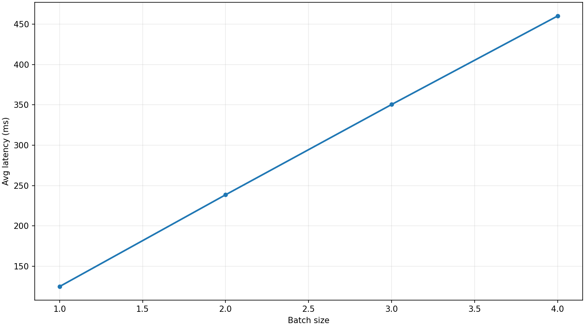
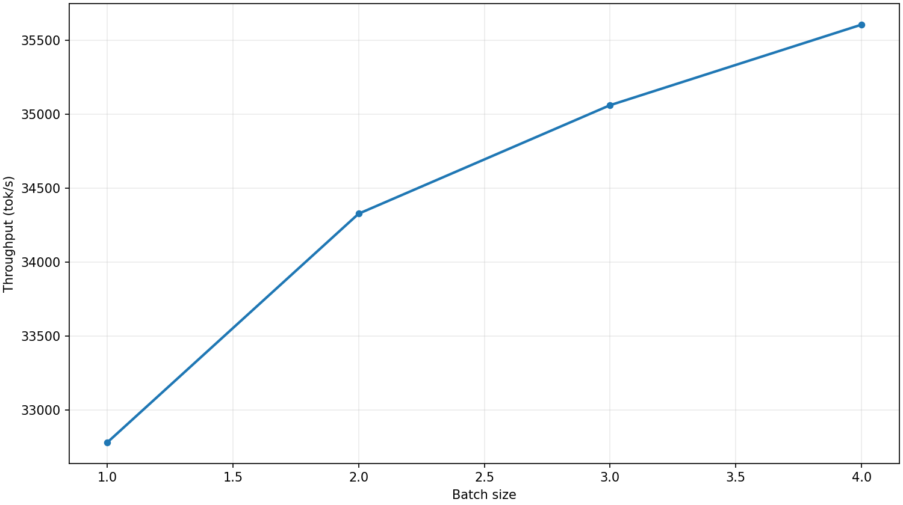
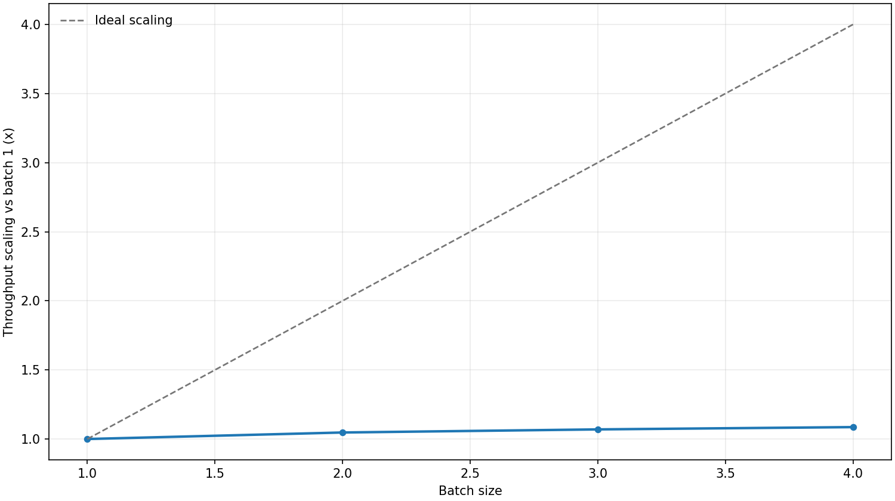

# Prefill-Direct Input 4096 TP=4 性能报告

## 运行环境

| 项目 | 值 |
| --- | --- |
| 日期 | 2026-11-18 15:58:44-15:59:29（Asia/Shanghai） |
| 平台 | NVIDIA |
| 设备 | 4 x A100-SXM4-80GB，默认 CUDA_VISIBLE_DEVICES=3,4,5,6 |
| Driver | 535.161.08 |
| InfiniLM build | 当前源码树；未记录独立 build ID |
| 模型 | `/data-aisoft/mechdancer/models/Qwen3-8B` |
| 模式 | `prefill-direct` |
| Attention backend | `flash-attn` |
| Graph request | enabled |
| Expected execution mode | `eager` |
| Cache | paged KV cache，block size 256，num blocks 64 |
| Max batched tokens | 18432 |
| Tensor parallel size | 4 |
| Input length | 4096 tokens / request |
| Batch size | 1..4 |
| Warmup | 每个形状 3 次 repeat |
| Measured repeats | 每个形状 30 次 repeat |
| Batch 执行顺序 | random seed 2026 |

本报告对应的原始 JSONL 和 log 为本机运行产物，不随仓库提交：

```text
../../../benchmark-prefill-direct-qwen3-8b-flash-attn-tp4-input4096-20261118.jsonl
../../../benchmark-prefill-direct-qwen3-8b-flash-attn-tp4-input4096-20261118.log
```

## 构建与测试命令

本轮使用当前已安装的 `_infinilm` 扩展。标准重建命令如下：

```bash
xmake build _infinilm && xmake install _infinilm
```

性能测试命令：

```bash
BENCHMARK_MODE=prefill-direct \
BATCH_SIZES="1,2,3,4" \
INPUT_LENS=4096 \
BENCHMARK_REPEATS=30 \
BENCHMARK_OUTPUT=benchmark-prefill-direct-qwen3-8b-flash-attn-tp4-input4096-20261118.jsonl \
./run_bench-nvidia.sh
```

## 执行模式与 Graph 覆盖

`run_bench-nvidia.sh` 请求开启 graph compiling，但 paged graph compiler 的 graph key 只匹配 decode-only 形状；packed prefill 形状不匹配该 key，因此本轮 expected execution mode 为 `eager`。该字段由 benchmark 根据 compiler 规则推断，不是 C++ runtime 回传的实际执行模式。

## 资源开销

| 项目 | 值 |
| --- | ---: |
| Workspace allocation | 每 rank 702 MiB，TP=4 合计 2,808 MiB |
| 权重加载时间 | 约 6.44 秒 |
| Paged cache blocks | 64 |
| 正式 sample 数 | 120 |
| 本轮总耗时 | 约 45 秒 |

Input length 4096 时，batch 4 的 prefill token 数为 `4 * 4096 = 16384`，低于 `max_num_batched_tokens=18432`，因此 workspace 上限保持 18432。

## 测试口径

- 每个 sample 是一次物理 prefill forward。
- `token_count = batch_size * 4096`。
- `throughput = token_count / avg_forward_duration_s`。
- 计时边界为 `engine_forward_including_sampling`。
- Direct prefill 使用合成输入和全 0 paged KV cache，输出 token 不用于正确性判断。
- 分位数使用线性插值；每个 batch 有 30 个正式样本，p99 只能作为尾部参考。

## 核心结果

| Batch | Input tokens | Avg ms | Min ms | P50 ms | P95 ms | P99 ms | Max ms | Std ms | Throughput tok/s | Scaling |
| ---: | ---: | ---: | ---: | ---: | ---: | ---: | ---: | ---: | ---: | ---: |
| 1 | 4,096 | 124.953 | 124.773 | 124.926 | 125.253 | 125.305 | 125.327 | 0.143 | 32,780.28 | 1.000x |
| 2 | 8,192 | 238.639 | 238.422 | 238.605 | 238.911 | 239.081 | 239.147 | 0.166 | 34,328.06 | 1.047x |
| 3 | 12,288 | 350.465 | 350.012 | 350.438 | 350.771 | 351.035 | 351.134 | 0.213 | 35,061.96 | 1.070x |
| 4 | 16,384 | 460.138 | 459.672 | 460.086 | 460.544 | 461.184 | 461.398 | 0.317 | 35,606.70 | 1.086x |

## 趋势图

### 1. Batch size 与 Avg Latency



平均 latency 从 batch 1 的 124.953 ms 增至 batch 4 的 460.138 ms。

### 2. Batch size 与 Throughput



吞吐峰值出现在 batch 4，为 35,606.70 tok/s；最大 batch 4 为 35,606.70 tok/s。

### 3. Batch size 与 Scaling



Scaling 从 batch 1 的 1.000x 变为 batch 4 的 1.086x；相对理想 4x 的效率约为 27.2%。

## 关键批次与区间

| Batch / range | 观察 |
| --- | --- |
| batch 1 -> 4 | 平均 latency 从 124.953 ms 增至 460.138 ms，为 3.682x。 |
| batch 4 | 吞吐峰值，35,606.70 tok/s。 |
| batch 4 | per-request prefill latency 最低，为 115.03 ms/request。 |

## 数据稳定性

- Std 中位数为 0.190 ms。
- 最大 std 为 0.317 ms，出现在 batch 4。
- P50、P95、P99 和 max 普遍接近，数据稳定性较好。


## TP=1 / TP=2 / TP=4 对比摘要

| 配置 | 峰值 batch | 峰值吞吐 tok/s | 峰值 Avg ms | TP=4 / 该配置吞吐 |
| --- | ---: | ---: | ---: | ---: |
| TP=1 | 4 | 11,842.50 | 1383.492 | 3.007x |
| TP=2 | 4 | 21,294.20 | 769.412 | 1.672x |
| TP=4 | 4 | 35,606.70 | 460.138 | 1.000x |


## 结论与建议

1. 在本轮 input length 4096、batch `1..4`、TP=4 范围内，**batch 4 吞吐最高**，约 35,606.70 tok/s。
2. batch 4 吞吐约 35,606.70 tok/s，与峰值差异约 0.00%；但单次 forward 平均耗时增加到 460.138 ms。
3. 若以单 request latency 为优先，batch 4 的 per-request latency 最低，为 115.03 ms/request。
4. 正式 p99 对比建议将 `BENCHMARK_REPEATS` 提高到 100 或以上。

## 数据完整性

```text
config records: 1
sample records: 120
overall summary records: 4
scaling records: 4
samples per batch: 30
```
