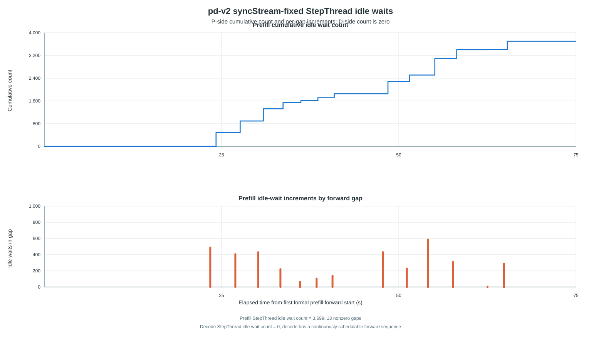
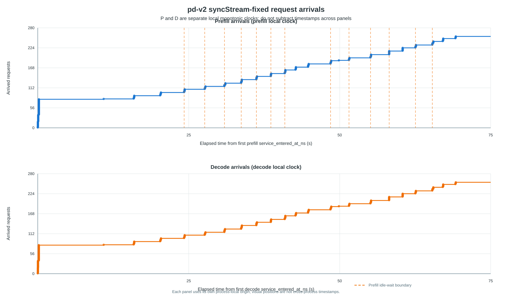

# InfiniLM PD 分离服务 Timing 实验报告（pd-v2，共享 Request ID）

> 本轮验证 `InferenceServer` 优先保留 Proxy 下发的 `X-Request-Id`。因此 P finish、D finish、P `kv_send` 和 D `kv_receive` 使用同一组 request id，可直接按 ID 建立 P/D/KV 映射；P/D timestamp 仍属于不同 local monotonic clock domain，不能跨进程相减。
>
> 报告状态：current V2 primary report。`analysis_reports/timing-pd-service-v2-256-syncstream-fixed-20261118.md` 保留为 `syncStream()` 修正后的历史基线，不应删除。本报告和图表、映射 CSV 位于 `docs/`；原始 timing、filtered timing、benchmark 和服务日志仍保存在 `analysis_reports/timing-pd-request-id-v2-256-20261120/`。

## 1. 执行摘要

| 指标 | 值 |
|---|---:|
| Successful requests | 256 |
| Failed requests | 0 |
| Benchmark duration s | 87.84 |
| Output token throughput tok/s | 1492.24 |
| Mean TTFT ms | 4903.87 |
| Mean E2EL ms | 25349.65 |
| Mean ITL ms | 39.99 |
| D KV readiness avg ms | 4615.85 |

本次数据的主要瓶颈分层：

1. TTFT 长尾主要由 D 侧远端 KV readiness 和 P 侧 prefill 到达/调度节奏决定。
2. E2E 主体是 512-token decode forward；输出路径耗时相对较小。
3. D 侧 `get_finished` 使用 `lock_snapshot`，connector finalize 控制面开销已处于优化后量级。

KV readiness vs D 服务内部 TTFT Pearson r = `1.0000`；KV readiness vs enqueue -> first decode forward Pearson r = `1.0000`。

## 2. 测试配置

| 项目 | 值 |
|---|---|
| 服务类型 | Mooncake PD 分离服务 |
| 测试时间 | 2026-11-20 17:12:10 - 2026-11-20 17:14:29 Asia/Shanghai |
| 模型 | /data-aisoft/mechdancer/models/Qwen3-8B |
| Timing | INFINILM_TIMING=true |
| Timing schema | v6 |
| max_num_batched_tokens | 18432 |
| warmup | 80 requests，分析时剔除 |
| benchmark script | run_matrix_reqs_v2.sh |
| Request ID policy | Proxy 生成并下发 `X-Request-Id`，P/D 后端保留 |
| git revision | 39eb93b1a94241a6fa12a96c40b8fbfaab25bb82 |
| Code state | 包含未提交的 `X-Request-Id` 保留修改 |
| Prefill PID | 1167100 |
| Decode PID | 1171386 |
| Proxy PID | 1175135 |
| P max batch | 32 |
| D max batch | 128 |
| D get_finished mode | lock_snapshot |
| StepThread 空闲策略 | Event.wait(timeout=0.003)，支持 notify 提前唤醒 |
| P/D 时间戳 | 各自 local monotonic clock，不跨进程相减 |

## 3. Benchmark 结果

| 指标 | 值 |
|---|---:|
| Successful requests | 256 |
| Failed requests | 0 |
| Benchmark duration s | 87.84 |
| Input token throughput tok/s | 5968.96 |
| Output token throughput tok/s | 1492.24 |
| Total token throughput tok/s | 7461.20 |

客户端请求级分布：

| 阶段 | count | avg | min | p50 | p95 | p99 | max |
|---|---:|---:|---:|---:|---:|---:|---:|
| TTFT ms | 256 | 4903.87 | 364.27 | 2449.55 | 16964.12 | 19035.09 | 19051.13 |
| E2EL ms | 256 | 25349.65 | 11051.66 | 24252.32 | 38696.76 | 41069.45 | 41080.71 |
| Mean ITL ms | 256 | 39.99 | 20.17 | 42.51 | 43.08 | 43.14 | 43.15 |

`Mean ITL ms` 按每个请求自身的 mean ITL 计算；benchmark 输出的 P99 ITL 是全部 token interval 的分位数，两者口径不同。

## 4. Timing 数据完整性

### Prefill

```text
filtered records = 813
finish = 256
token = 256
batch = 45
kv_send = 256
kv_receive = 0
batch request occurrence = 256
validator: parse_error_count=0, error_count=0, warning_count=0, valid=true
```

### Decode

```text
filtered records = 7,328
finish = 256
token = 4,352
batch = 2,464
kv_send = 0
kv_receive = 256
batch request occurrence = 131,072
validator: parse_error_count=0, error_count=0, warning_count=0, valid=true
```

### P/D KV 一致性

```text
request ids equal = True
request count = 256 / 256
block count = 2048 / 2048
bytes = 77309411328 / 77309411328
success count = 256 / 256
```

P 侧 `kv_send` request event 会复制物理 batch 的 bytes/block_count。总量统计按 `(pid, batch_id)` 去重后使用 `batch_bytes` / `batch_block_count`。

### P/D Request ID 映射

```text
P finish request ids = D finish request ids = P kv_send request ids = D kv_receive request ids
request count = 256
P/D/KV symmetric difference = 0
```

本次共享 ID 只解决跨进程实体映射问题，不改变时钟口径。P 侧 `service_entered_at_ns` 与 D 侧 `service_entered_at_ns` 仍分别来自两个进程的 local monotonic clock，不能相减；两个进程的 request 到达图也必须分面板展示。

## 5. Prefill 侧请求级耗时

| 阶段 | count | avg | min | p50 | p95 | p99 | max |
|---|---:|---:|---:|---:|---:|---:|---:|
| service -> enqueue | 256 | 69.784 | 6.893 | 22.388 | 297.304 | 363.433 | 379.349 |
| enqueue -> forward start | 256 | 2709.212 | 1.363 | 225.062 | 14155.375 | 16155.512 | 16171.977 |
| forward | 256 | 1771.917 | 237.246 | 2029.793 | 2054.440 | 2054.851 | 2054.851 |
| forward complete -> loop submit | 256 | 1.487 | 0.735 | 1.511 | 1.864 | 1.905 | 2.308 |
| loop submit -> batch put start | 256 | 6.013 | 0.233 | 5.289 | 12.884 | 26.681 | 313.930 |
| batch put | 256 | 2.351 | 0.016 | 1.988 | 5.706 | 6.787 | 6.787 |
| batch put -> route received | 256 | 3.058 | 0.294 | 2.708 | 7.722 | 10.921 | 14.550 |
| route token | 256 | 3.787 | 0.168 | 3.670 | 7.234 | 13.509 | 18.587 |
| service -> first route | 256 | 4563.821 | 259.810 | 2270.707 | 16518.728 | 18574.811 | 18574.881 |
| service -> first route end | 256 | 4567.608 | 260.257 | 2274.057 | 16522.491 | 18579.516 | 18580.040 |
| service -> final route | 256 | 4567.608 | 260.257 | 2274.057 | 16522.491 | 18579.516 | 18580.040 |

## 6. Prefill Batch 与 Forward

| batch size | batch count | request occurrence | request occurrence 占比 |
|---:|---:|---:|---:|
| 1 | 15 | 15 | 5.86% |
| 3 | 1 | 3 | 1.17% |
| 6 | 3 | 18 | 7.03% |
| 7 | 3 | 21 | 8.20% |
| 8 | 8 | 64 | 25.00% |
| 9 | 15 | 135 | 52.73% |

| 阶段 | count | avg | min | p50 | p95 | p99 | max |
|---|---:|---:|---:|---:|---:|---:|---:|
| batch=1 | 15 | 238.898 | 237.246 | 238.874 | 240.291 | 240.686 | 240.784 |
| batch=3 | 1 | 686.281 | 686.281 | 686.281 | 686.281 | 686.281 | 686.281 |
| batch=6 | 3 | 1360.084 | 1358.376 | 1359.265 | 1362.275 | 1362.543 | 1362.610 |
| batch=7 | 3 | 1575.219 | 1574.351 | 1575.629 | 1575.673 | 1575.677 | 1575.678 |
| batch=8 | 8 | 1792.766 | 1790.592 | 1792.220 | 1796.079 | 1797.171 | 1797.444 |
| batch=9 | 15 | 2042.002 | 2029.793 | 2038.321 | 2054.563 | 2054.794 | 2054.851 |
| All | 45 | 1289.951 | 237.246 | 1790.592 | 2052.623 | 2054.670 | 2054.851 |

| batch size | forward avg ms | 每请求摊销 ms | request occurrence |
|---:|---:|---:|---:|
| 1 | 238.90 | 238.90 | 15 |
| 3 | 686.28 | 228.76 | 3 |
| 6 | 1360.08 | 226.68 | 18 |
| 7 | 1575.22 | 225.03 | 21 |
| 8 | 1792.77 | 224.10 | 64 |
| 9 | 2042.00 | 226.89 | 135 |

P 侧大 batch 可以降低少量物理 GPU 总耗时，但同 batch 内每个 request 都要等待整个 prefill forward 完成，会放大 request-weighted prefill forward、KV readiness 和 TTFT。分析 P batching 时必须同时看物理 batch 平均和 request-weighted 平均。

### 6.1 Forward Batch 与 KV Send Batch 映射

共享 `X-Request-Id` 后，可以直接用 request id 将 P forward batch、`kv_send` batch 和 D `kv_receive` 事件关联：

```text
finish.request_id / batch.request_ids / kv_send.request_id / kv_receive.request_id
```

映射完整性：

```text
P finish = D finish = P kv_send = D kv_receive = 256 个 request id
P/D/KV symmetric difference = 0
P/D batch request occurrence 覆盖各自 256 个 finish request，无缺失、无多余
```

45 个 P forward batch 到 140 个 KV send batch 的拆分分布如下：

| 一个 P forward 拆成的 KV send batch 数 | P forward 数量 |
|---:|---:|
| 1 | 16 |
| 3 | 16 |
| 4 | 5 |
| 5 | 3 |
| 6 | 1 |
| 8 | 1 |
| 9 | 3 |

按 P forward size 拆分：

| P forward size | forward 次数 | 拆成 KV send batch 数分布 |
|---:|---:|---|
| 1 | 15 | `1:15` |
| 3 | 1 | `1:1` |
| 6 | 3 | `3:3` |
| 7 | 3 | `3:3` |
| 8 | 8 | `3:7, 4:1` |
| 9 | 15 | `3:3, 4:4, 5:3, 6:1, 8:1, 9:3` |

本轮所有 140 个 KV send batch 都只包含同一个 P forward batch 内的 request，没有出现 KV send 跨 P forward batch 合并。也就是说，拆分主要发生在 forward 内部的 ready-request 子集上：P forward batch=9 的大部分 request 并没有在同一个 `asyncio.wait()` 返回中一起发送，而是按 ready 时序拆成多个更小的 KV send batch。

该结论只描述本轮观察到的实际时序，不是协议约束。Mooncake sender 的代码边界仍允许一个 D metadata 混合不同 P forward 的 request；只是本轮 D metadata 分组与 P forward 分组没有产生跨 forward 合并。

明细数据：

```text
docs/timing-pd-request-id-v2-256-20261120/request-id-forward-kv-send-mapping-20261120.csv
docs/timing-pd-request-id-v2-256-20261120/forward-to-kv-send-mapping-20261120.csv
```

## 7. KV Connector Finalize

### Prefill

| 阶段 | count | avg | min | p50 | p95 | p99 | max |
|---|---:|---:|---:|---:|---:|---:|---:|
| forward -> finalize start | 45 | 0.333 | 0.158 | 0.381 | 0.416 | 0.435 | 0.441 |
| kv_connector_finalize | 45 | 0.520 | 0.275 | 0.500 | 0.726 | 1.491 | 2.046 |
| kv_connector_get_finished | 45 | 0.506 | 0.262 | 0.484 | 0.714 | 1.481 | 2.041 |
| finalize remaining | 45 | 0.014 | 0.005 | 0.014 | 0.017 | 0.020 | 0.023 |
| finalize -> loop submit | 0 | - | - | - | - | - | - |

### Decode

| 阶段 | count | avg | min | p50 | p95 | p99 | max |
|---|---:|---:|---:|---:|---:|---:|---:|
| forward -> finalize start | 2,464 | 0.247 | 0.065 | 0.236 | 0.357 | 0.390 | 0.678 |
| kv_connector_finalize | 2,464 | 0.026 | 0.008 | 0.027 | 0.034 | 0.047 | 0.109 |
| kv_connector_get_finished | 2,464 | 0.017 | 0.005 | 0.017 | 0.022 | 0.034 | 0.082 |
| finalize remaining | 2,464 | 0.009 | 0.003 | 0.009 | 0.012 | 0.018 | 0.051 |
| finalize -> loop submit | 0 | - | - | - | - | - | - |

D 侧当前使用 `lock_snapshot`。该模式下 receiver loop 用锁发布 finished/failed 状态，StepThread 直接交换本地 snapshot，不再提交两个跨线程 future。

## 8. Mooncake KV Transfer

Unique send batch count `140`；batch 分布 `1:75, 2:35, 3:15, 4:9, 5:6`。

| 阶段 | count | avg | min | p50 | p95 | p99 | max |
|---|---:|---:|---:|---:|---:|---:|---:|
| KV ready -> write start | 256 | 5.658 | 0.737 | 5.508 | 9.746 | 10.309 | 11.190 |
| write, request-weighted | 256 | 40.682 | 6.339 | 41.535 | 62.048 | 65.669 | 65.669 |
| write, batch-weighted | 140 | 34.015 | 6.339 | 36.351 | 57.508 | 63.826 | 65.669 |
| KV pull readiness | 256 | 4615.854 | 246.209 | 2250.272 | 16241.696 | 18234.925 | 18238.993 |
| KV ready -> first decode forward | 256 | 24.973 | 2.595 | 25.013 | 47.119 | 48.446 | 48.446 |

`kv_cache_pull_readiness_ms` 包含 bootstrap/agent 查询、ZMQ control plane、等待 P 侧 prefill 完成和 Mooncake 传输确认，不是纯 RDMA 传输时间。P/D 使用不同进程 local monotonic clock，不做跨进程 timestamp 相减。

## 9. Decode 侧请求级耗时

| 阶段 | count | avg | min | p50 | p95 | p99 | max |
|---|---:|---:|---:|---:|---:|---:|---:|
| service -> enqueue | 256 | 80.106 | 6.553 | 21.903 | 323.912 | 395.361 | 412.798 |
| enqueue -> forward start | 256 | 4660.888 | 260.630 | 2298.106 | 16260.028 | 18275.548 | 18294.335 |
| forward | 256 | 35.505 | 13.772 | 37.791 | 40.815 | 41.258 | 41.258 |
| forward complete -> loop submit | 256 | 2.882 | 0.367 | 3.095 | 4.360 | 4.417 | 4.556 |
| loop submit -> batch put start | 256 | 2.809 | 0.204 | 1.312 | 2.076 | 22.100 | 298.638 |
| batch put | 256 | 1.305 | 0.016 | 1.341 | 2.177 | 2.848 | 2.848 |
| batch put -> route received | 256 | 4.312 | 0.487 | 4.622 | 5.666 | 5.939 | 6.029 |
| route token | 256 | 4.638 | 0.159 | 5.128 | 6.243 | 7.802 | 8.164 |
| service -> first route | 256 | 4787.809 | 338.478 | 2378.637 | 16644.095 | 18720.905 | 18721.139 |
| service -> first route end | 256 | 4792.446 | 343.670 | 2385.947 | 16648.194 | 18726.053 | 18726.141 |
| service -> final route | 256 | 25238.679 | 10903.809 | 24179.137 | 38379.646 | 40760.224 | 40760.561 |

客户端 TTFT 分布：

| TTFT 范围 | 请求数 | 占比 |
|---|---:|---:|
| <1 s | 3 | 1.17% |
| 1-5 s | 191 | 74.61% |
| 5-10 s | 18 | 7.03% |
| 10-15 s | 28 | 10.94% |
| 15-20 s | 16 | 6.25% |
| >=20 s | 0 | 0.00% |

KV readiness vs D 服务内部 TTFT Pearson r = `1.0000`；KV readiness vs enqueue -> first decode forward Pearson r = `1.0000`。

## 10. Decode Forward 与 Batch

| batch size | batch count | request occurrence | request occurrence 占比 |
|---:|---:|---:|---:|
| 1 | 144 | 144 | 0.11% |
| 2 | 1 | 2 | 0.00% |
| 4 | 2 | 8 | 0.01% |
| 6 | 31 | 186 | 0.14% |
| 10 | 113 | 1,130 | 0.86% |
| 11 | 1 | 11 | 0.01% |
| 14 | 42 | 588 | 0.45% |
| 15 | 1 | 15 | 0.01% |
| 19 | 92 | 1,748 | 1.33% |
| 22 | 1 | 22 | 0.02% |
| 24 | 76 | 1,824 | 1.39% |
| 27 | 1 | 27 | 0.02% |
| 28 | 78 | 2,184 | 1.67% |
| 29 | 1 | 29 | 0.02% |
| 32 | 45 | 1,440 | 1.10% |
| 33 | 1 | 33 | 0.03% |
| 36 | 87 | 3,132 | 2.39% |
| 40 | 1 | 40 | 0.03% |
| 41 | 31 | 1,271 | 0.97% |
| 42 | 1 | 42 | 0.03% |
| 44 | 56 | 2,464 | 1.88% |
| 45 | 8 | 360 | 0.27% |
| 48 | 1 | 48 | 0.04% |
| 49 | 1 | 49 | 0.04% |
| 50 | 49 | 2,450 | 1.87% |
| 51 | 26 | 1,326 | 1.01% |
| 54 | 82 | 4,428 | 3.38% |
| 56 | 1 | 56 | 0.04% |
| 60 | 94 | 5,640 | 4.30% |
| 62 | 88 | 5,456 | 4.16% |
| 63 | 51 | 3,213 | 2.45% |
| 64 | 1 | 64 | 0.05% |
| 65 | 2 | 130 | 0.10% |
| 67 | 60 | 4,020 | 3.07% |
| 68 | 6 | 408 | 0.31% |
| 69 | 1 | 69 | 0.05% |
| 70 | 165 | 11,550 | 8.81% |
| 71 | 437 | 31,027 | 23.67% |
| 72 | 194 | 13,968 | 10.66% |
| 73 | 80 | 5,840 | 4.46% |
| 74 | 3 | 222 | 0.17% |
| 75 | 5 | 375 | 0.29% |
| 76 | 19 | 1,444 | 1.10% |
| 77 | 42 | 3,234 | 2.47% |
| 79 | 5 | 395 | 0.30% |
| 80 | 237 | 18,960 | 14.47% |

| 阶段 | count | avg | min | p50 | p95 | p99 | max |
|---|---:|---:|---:|---:|---:|---:|---:|
| batch=1 | 144 | 13.410 | 13.270 | 13.381 | 13.631 | 14.330 | 14.602 |
| batch=2 | 1 | 15.223 | 15.223 | 15.223 | 15.223 | 15.223 | 15.223 |
| batch=4 | 2 | 15.763 | 15.698 | 15.763 | 15.821 | 15.826 | 15.828 |
| batch=6 | 31 | 16.252 | 16.118 | 16.245 | 16.416 | 16.485 | 16.511 |
| batch=10 | 113 | 16.866 | 16.676 | 16.840 | 16.968 | 17.953 | 18.254 |
| batch=11 | 1 | 18.225 | 18.225 | 18.225 | 18.225 | 18.225 | 18.225 |
| batch=14 | 42 | 19.459 | 19.321 | 19.434 | 19.652 | 19.764 | 19.832 |
| batch=15 | 1 | 19.713 | 19.713 | 19.713 | 19.713 | 19.713 | 19.713 |
| batch=19 | 92 | 20.940 | 20.773 | 20.895 | 21.075 | 21.978 | 22.720 |
| batch=22 | 1 | 22.442 | 22.442 | 22.442 | 22.442 | 22.442 | 22.442 |
| batch=24 | 76 | 24.261 | 24.031 | 24.263 | 24.433 | 24.494 | 24.514 |
| batch=27 | 1 | 25.859 | 25.859 | 25.859 | 25.859 | 25.859 | 25.859 |
| batch=28 | 78 | 23.917 | 23.694 | 23.889 | 24.132 | 24.447 | 24.781 |
| batch=29 | 1 | 25.464 | 25.464 | 25.464 | 25.464 | 25.464 | 25.464 |
| batch=32 | 45 | 27.075 | 26.891 | 27.052 | 27.252 | 27.438 | 27.490 |
| batch=33 | 1 | 24.810 | 24.810 | 24.810 | 24.810 | 24.810 | 24.810 |
| batch=36 | 87 | 26.212 | 25.558 | 25.852 | 27.928 | 28.030 | 28.127 |
| batch=40 | 1 | 29.185 | 29.185 | 29.185 | 29.185 | 29.185 | 29.185 |
| batch=41 | 31 | 29.126 | 28.777 | 29.184 | 29.372 | 29.576 | 29.659 |
| batch=42 | 1 | 27.476 | 27.476 | 27.476 | 27.476 | 27.476 | 27.476 |
| batch=44 | 56 | 28.321 | 28.056 | 28.305 | 28.513 | 29.171 | 29.742 |
| batch=45 | 8 | 28.541 | 28.438 | 28.545 | 28.634 | 28.639 | 28.641 |
| batch=48 | 1 | 30.427 | 30.427 | 30.427 | 30.427 | 30.427 | 30.427 |
| batch=49 | 1 | 31.731 | 31.731 | 31.731 | 31.731 | 31.731 | 31.731 |
| batch=50 | 49 | 31.532 | 31.308 | 31.504 | 31.719 | 31.903 | 31.984 |
| batch=51 | 26 | 31.755 | 31.562 | 31.708 | 32.020 | 32.266 | 32.340 |
| batch=54 | 82 | 31.706 | 31.212 | 31.674 | 32.185 | 32.539 | 32.632 |
| batch=56 | 1 | 33.905 | 33.905 | 33.905 | 33.905 | 33.905 | 33.905 |
| batch=60 | 94 | 35.080 | 33.252 | 35.048 | 35.564 | 35.764 | 35.867 |
| batch=62 | 88 | 35.296 | 33.187 | 34.748 | 36.067 | 45.426 | 103.642 |
| batch=63 | 51 | 35.462 | 34.097 | 34.528 | 36.761 | 49.705 | 62.140 |
| batch=64 | 1 | 36.170 | 36.170 | 36.170 | 36.170 | 36.170 | 36.170 |
| batch=65 | 2 | 36.253 | 36.106 | 36.253 | 36.385 | 36.397 | 36.400 |
| batch=67 | 60 | 37.063 | 36.195 | 37.084 | 37.337 | 37.647 | 37.729 |
| batch=68 | 6 | 37.093 | 36.352 | 37.279 | 37.388 | 37.390 | 37.390 |
| batch=69 | 1 | 37.650 | 37.650 | 37.650 | 37.650 | 37.650 | 37.650 |
| batch=70 | 165 | 38.404 | 37.162 | 37.913 | 38.347 | 39.901 | 113.067 |
| batch=71 | 437 | 38.171 | 37.395 | 38.015 | 38.460 | 39.648 | 94.791 |
| batch=72 | 194 | 38.744 | 37.544 | 38.233 | 38.653 | 39.558 | 131.150 |
| batch=73 | 80 | 38.651 | 38.317 | 38.607 | 38.960 | 39.597 | 40.087 |
| batch=74 | 3 | 39.470 | 39.064 | 39.131 | 40.108 | 40.195 | 40.216 |
| batch=75 | 5 | 39.241 | 38.982 | 39.265 | 39.494 | 39.500 | 39.502 |
| batch=76 | 19 | 39.357 | 39.068 | 39.273 | 39.813 | 40.085 | 40.153 |
| batch=77 | 42 | 39.979 | 39.091 | 40.020 | 40.644 | 40.659 | 40.663 |
| batch=79 | 5 | 40.561 | 40.322 | 40.483 | 40.788 | 40.797 | 40.800 |
| batch=80 | 237 | 41.101 | 40.328 | 40.808 | 41.110 | 41.319 | 112.746 |
| All | 2,464 | 32.237 | 13.270 | 37.070 | 40.811 | 41.065 | 131.150 |

| batch size | forward avg ms | 理论 token 生产力 tok/s | request occurrence |
|---:|---:|---:|---:|
| 1 | 13.41 | 74.57 | 144 |
| 2 | 15.22 | 131.38 | 2 |
| 4 | 15.76 | 253.76 | 8 |
| 6 | 16.25 | 369.19 | 186 |
| 10 | 16.87 | 592.92 | 1,130 |
| 11 | 18.22 | 603.57 | 11 |
| 14 | 19.46 | 719.45 | 588 |
| 15 | 19.71 | 760.93 | 15 |
| 19 | 20.94 | 907.37 | 1,748 |
| 22 | 22.44 | 980.28 | 22 |
| 24 | 24.26 | 989.25 | 1,824 |
| 27 | 25.86 | 1044.11 | 27 |
| 28 | 23.92 | 1170.73 | 2,184 |
| 29 | 25.46 | 1138.86 | 29 |
| 32 | 27.07 | 1181.92 | 1,440 |
| 33 | 24.81 | 1330.10 | 33 |
| 36 | 26.21 | 1373.43 | 3,132 |
| 40 | 29.19 | 1370.56 | 40 |
| 41 | 29.13 | 1407.70 | 1,271 |
| 42 | 27.48 | 1528.62 | 42 |
| 44 | 28.32 | 1553.62 | 2,464 |
| 45 | 28.54 | 1576.71 | 360 |
| 48 | 30.43 | 1577.57 | 48 |
| 49 | 31.73 | 1544.23 | 49 |
| 50 | 31.53 | 1585.70 | 2,450 |
| 51 | 31.76 | 1606.04 | 1,326 |
| 54 | 31.71 | 1703.16 | 4,428 |
| 56 | 33.91 | 1651.66 | 56 |
| 60 | 35.08 | 1710.36 | 5,640 |
| 62 | 35.30 | 1756.57 | 5,456 |
| 63 | 35.46 | 1776.57 | 3,213 |
| 64 | 36.17 | 1769.42 | 64 |
| 65 | 36.25 | 1792.95 | 130 |
| 67 | 37.06 | 1807.75 | 4,020 |
| 68 | 37.09 | 1833.23 | 408 |
| 69 | 37.65 | 1832.67 | 69 |
| 70 | 38.40 | 1822.74 | 11,550 |
| 71 | 38.17 | 1860.06 | 31,027 |
| 72 | 38.74 | 1858.38 | 13,968 |
| 73 | 38.65 | 1888.72 | 5,840 |
| 74 | 39.47 | 1874.83 | 222 |
| 75 | 39.24 | 1911.27 | 375 |
| 76 | 39.36 | 1931.06 | 1,444 |
| 77 | 39.98 | 1926.00 | 3,234 |
| 79 | 40.56 | 1947.67 | 395 |
| 80 | 41.10 | 1946.42 | 18,960 |

## 11. Decode 输出路径

| 阶段 | count | avg | min | p50 | p95 | p99 | max |
|---|---:|---:|---:|---:|---:|---:|---:|
| decode forward | 4,096 | 36.169 | 13.321 | 37.984 | 40.886 | 41.076 | 131.150 |
| forward complete -> loop submit | 4,096 | 2.940 | 0.262 | 2.986 | 4.218 | 4.578 | 5.413 |
| loop submit -> batch put start | 4,096 | 1.260 | 0.062 | 0.982 | 1.540 | 10.697 | 34.678 |
| batch put | 4,096 | 1.180 | 0.030 | 1.236 | 1.796 | 2.566 | 4.191 |
| batch put -> route received | 4,096 | 4.284 | 0.171 | 3.370 | 5.294 | 27.538 | 121.499 |
| route token | 4,096 | 3.642 | 0.252 | 3.533 | 5.139 | 7.035 | 59.409 |

## 12. GPU Forward 空泡时间

### 12.1 统计口径

P 和 D 是两个独立进程、独立 GPU 序列和独立 local monotonic clock。本节分别在每个进程内排序 batch event 并计算 forward gap，不跨进程相减，也不合并 P/D GPU 利用率。

### 12.2 Prefill GPU

| 指标 | 值 |
|---|---:|
| 物理 batch 次数 | 45 |
| 相邻 interval 数量 | 44 |
| 第一次 forward 开始 -> 最后一次 forward 结束 ms | 70785.60 |
| 纯 forward 计算时间 ms | 58047.82 |
| 纯 prefill forward 计算时间 ms | 58047.82 |
| forward 空泡时间 ms | 12737.79 |
| 纯 forward 计算占比 | 82.01% |
| forward 空泡占比 | 17.99% |
| StepThread idle wait count | 3,699 |

| 阶段 | count | avg | min | p50 | p95 | p99 | max |
|---|---:|---:|---:|---:|---:|---:|---:|
| All forward gaps | 44 | 289.495 | 3.571 | 8.969 | 1452.079 | 1819.898 | 1958.323 |

阈值分布：

| Gap 阈值 | 数量 | 累计耗时 ms | 占总空泡比例 |
|---:|---:|---:|---:|
| >= 0.50 ms | 44 | 12737.79 | 100.00% |
| >= 1 ms | 44 | 12737.79 | 100.00% |
| >= 2 ms | 44 | 12737.79 | 100.00% |
| >= 5 ms | 42 | 12729.71 | 99.94% |
| >= 10 ms | 16 | 12517.47 | 98.27% |
| >= 20 ms | 12 | 12464.58 | 97.86% |

### 12.3 Decode GPU

| 指标 | 值 |
|---|---:|
| 物理 batch 次数 | 2,464 |
| 相邻 interval 数量 | 2,463 |
| 第一次 forward 开始 -> 最后一次 forward 结束 ms | 87404.64 |
| 纯 forward 计算时间 ms | 79431.94 |
| 纯 decode forward 计算时间 ms | 79431.94 |
| forward 空泡时间 ms | 7972.71 |
| 纯 forward 计算占比 | 90.88% |
| forward 空泡占比 | 9.12% |
| StepThread idle wait count | 0 |

| 阶段 | count | avg | min | p50 | p95 | p99 | max |
|---|---:|---:|---:|---:|---:|---:|---:|
| All forward gaps | 2,463 | 3.237 | 0.417 | 3.435 | 5.095 | 6.226 | 12.889 |

阈值分布：

| Gap 阈值 | 数量 | 累计耗时 ms | 占总空泡比例 |
|---:|---:|---:|---:|
| >= 0.50 ms | 2,453 | 7967.96 | 99.94% |
| >= 1 ms | 2,291 | 7839.39 | 98.33% |
| >= 2 ms | 1,984 | 7405.49 | 92.89% |
| >= 5 ms | 143 | 842.76 | 10.57% |
| >= 10 ms | 6 | 70.02 | 0.88% |
| >= 20 ms | 0 | 0 | 0.00% |

### 12.4 Prefill batch 转移

| 阶段 | count | avg | min | p50 | p95 | p99 | max |
|---|---:|---:|---:|---:|---:|---:|---:|
| prefill=8 -> prefill=1 | 5 | 702.696 | 3.571 | 744.776 | 1297.484 | 1348.510 | 1361.267 |
| prefill=9 -> prefill=1 | 3 | 1107.052 | 232.241 | 1452.509 | 1618.016 | 1632.727 | 1636.405 |
| prefill=7 -> prefill=1 | 3 | 970.416 | 484.549 | 977.054 | 1402.387 | 1440.194 | 1449.646 |
| prefill=6 -> prefill=1 | 1 | 1958.323 | 1958.323 | 1958.323 | 1958.323 | 1958.323 | 1958.323 |
| prefill=1 -> prefill=1 | 1 | 763.946 | 763.946 | 763.946 | 763.946 | 763.946 | 763.946 |
| prefill=9 -> prefill=9 | 8 | 8.400 | 7.628 | 8.347 | 9.250 | 9.276 | 9.283 |
| prefill=1 -> prefill=9 | 5 | 8.212 | 7.066 | 8.330 | 9.141 | 9.199 | 9.214 |
| prefill=1 -> prefill=8 | 5 | 8.123 | 7.213 | 7.972 | 9.144 | 9.268 | 9.299 |
| prefill=9 -> prefill=8 | 3 | 10.738 | 8.862 | 11.411 | 11.888 | 11.930 | 11.941 |
| prefill=1 -> prefill=7 | 3 | 8.002 | 7.183 | 8.405 | 8.415 | 8.416 | 8.416 |
| prefill=8 -> prefill=9 | 2 | 11.081 | 9.452 | 11.081 | 12.547 | 12.678 | 12.710 |
| prefill=3 -> prefill=1 | 1 | 16.822 | 16.822 | 16.822 | 16.822 | 16.822 | 16.822 |
| prefill=1 -> prefill=6 | 1 | 7.692 | 7.692 | 7.692 | 7.692 | 7.692 | 7.692 |
| prefill=8 -> prefill=6 | 1 | 7.643 | 7.643 | 7.643 | 7.643 | 7.643 | 7.643 |
| prefill=9 -> prefill=6 | 1 | 5.712 | 5.712 | 5.712 | 5.712 | 5.712 | 5.712 |
| prefill=6 -> prefill=3 | 1 | 4.506 | 4.506 | 4.506 | 4.506 | 4.506 | 4.506 |

### 12.5 Decode batch 转移

| 阶段 | count | avg | min | p50 | p95 | p99 | max |
|---|---:|---:|---:|---:|---:|---:|---:|
| decode=71 -> decode=71 | 425 | 3.848 | 1.969 | 3.795 | 5.011 | 5.821 | 7.676 |
| decode=80 -> decode=80 | 225 | 4.150 | 2.256 | 4.223 | 5.278 | 5.869 | 6.191 |
| decode=72 -> decode=72 | 187 | 3.672 | 2.114 | 3.751 | 4.886 | 5.216 | 5.255 |
| decode=70 -> decode=70 | 159 | 3.883 | 2.143 | 3.885 | 5.135 | 6.414 | 7.368 |
| decode=60 -> decode=60 | 91 | 3.782 | 2.885 | 3.723 | 4.793 | 5.574 | 6.319 |
| decode=62 -> decode=62 | 83 | 3.665 | 2.320 | 3.558 | 4.945 | 5.520 | 5.804 |
| decode=73 -> decode=73 | 75 | 3.703 | 2.059 | 3.696 | 5.091 | 5.185 | 5.274 |
| decode=54 -> decode=54 | 80 | 3.439 | 1.497 | 3.310 | 4.447 | 5.341 | 5.661 |
| decode=36 -> decode=36 | 85 | 2.902 | 2.046 | 2.899 | 3.660 | 4.421 | 6.443 |
| decode=67 -> decode=67 | 54 | 3.895 | 3.070 | 3.791 | 4.720 | 4.947 | 4.963 |
| decode=24 -> decode=24 | 75 | 2.367 | 1.744 | 2.385 | 2.915 | 3.762 | 5.685 |
| decode=63 -> decode=63 | 46 | 3.782 | 2.287 | 3.633 | 5.280 | 6.052 | 6.100 |
| decode=44 -> decode=44 | 55 | 3.020 | 1.207 | 2.819 | 3.857 | 4.695 | 4.809 |
| decode=50 -> decode=50 | 48 | 3.420 | 2.307 | 3.233 | 4.406 | 5.363 | 5.446 |
| decode=77 -> decode=77 | 36 | 4.422 | 3.460 | 4.384 | 5.222 | 5.812 | 6.106 |
| decode=10 -> decode=10 | 111 | 1.334 | 0.498 | 1.393 | 1.664 | 2.515 | 2.808 |
| decode=28 -> decode=28 | 77 | 1.913 | 0.931 | 2.002 | 2.765 | 3.719 | 6.565 |
| decode=19 -> decode=19 | 90 | 1.377 | 0.910 | 1.337 | 1.659 | 1.772 | 1.988 |
| decode=1 -> decode=1 | 143 | 0.833 | 0.417 | 0.802 | 1.421 | 1.716 | 1.851 |
| decode=32 -> decode=32 | 44 | 2.568 | 1.478 | 2.484 | 3.130 | 3.295 | 3.305 |
| decode=41 -> decode=41 | 30 | 3.515 | 2.311 | 3.580 | 4.316 | 4.624 | 4.740 |
| decode=51 -> decode=51 | 25 | 3.512 | 2.618 | 3.373 | 4.493 | 4.703 | 4.760 |
| decode=14 -> decode=14 | 41 | 1.550 | 1.243 | 1.489 | 1.944 | 2.051 | 2.075 |
| decode=76 -> decode=76 | 13 | 2.755 | 2.225 | 2.643 | 3.316 | 3.528 | 3.581 |
| decode=6 -> decode=6 | 30 | 0.886 | 0.734 | 0.846 | 1.140 | 1.162 | 1.170 |
| decode=75 -> decode=80 | 3 | 8.765 | 6.221 | 7.185 | 12.318 | 12.775 | 12.889 |
| decode=45 -> decode=45 | 7 | 3.458 | 2.846 | 3.542 | 3.755 | 3.773 | 3.778 |
| decode=80 -> decode=77 | 4 | 4.512 | 3.916 | 4.465 | 5.165 | 5.193 | 5.200 |
| decode=73 -> decode=80 | 2 | 8.584 | 4.949 | 8.584 | 11.854 | 12.145 | 12.218 |
| decode=62 -> decode=67 | 2 | 8.005 | 4.851 | 8.005 | 10.843 | 11.096 | 11.159 |
| decode=79 -> decode=79 | 3 | 4.908 | 4.769 | 4.776 | 5.139 | 5.172 | 5.180 |
| decode=64 -> decode=71 | 1 | 12.122 | 12.122 | 12.122 | 12.122 | 12.122 | 12.122 |
| decode=67 -> decode=72 | 2 | 5.763 | 5.211 | 5.763 | 6.259 | 6.303 | 6.314 |
| decode=68 -> decode=68 | 3 | 3.714 | 3.642 | 3.693 | 3.795 | 3.804 | 3.806 |
| decode=63 -> decode=67 | 1 | 10.893 | 10.893 | 10.893 | 10.893 | 10.893 | 10.893 |
| decode=72 -> decode=75 | 1 | 10.740 | 10.740 | 10.740 | 10.740 | 10.740 | 10.740 |
| decode=71 -> decode=75 | 2 | 5.345 | 4.975 | 5.345 | 5.678 | 5.708 | 5.715 |
| decode=70 -> decode=71 | 2 | 5.337 | 4.757 | 5.337 | 5.859 | 5.906 | 5.918 |
| decode=80 -> decode=74 | 2 | 5.247 | 4.618 | 5.247 | 5.813 | 5.863 | 5.876 |
| decode=76 -> decode=80 | 2 | 5.192 | 4.935 | 5.192 | 5.424 | 5.445 | 5.450 |
| decode=77 -> decode=71 | 2 | 5.074 | 4.042 | 5.074 | 6.004 | 6.086 | 6.107 |
| decode=70 -> decode=80 | 1 | 9.703 | 9.703 | 9.703 | 9.703 | 9.703 | 9.703 |
| decode=72 -> decode=76 | 1 | 9.687 | 9.687 | 9.687 | 9.687 | 9.687 | 9.687 |
| decode=80 -> decode=76 | 2 | 4.585 | 4.253 | 4.585 | 4.884 | 4.911 | 4.917 |
| decode=71 -> decode=73 | 2 | 4.562 | 4.320 | 4.562 | 4.780 | 4.799 | 4.804 |
| decode=63 -> decode=71 | 1 | 8.989 | 8.989 | 8.989 | 8.989 | 8.989 | 8.989 |
| decode=67 -> decode=63 | 2 | 4.296 | 3.958 | 4.296 | 4.600 | 4.627 | 4.634 |
| decode=29 -> decode=33 | 1 | 8.376 | 8.376 | 8.376 | 8.376 | 8.376 | 8.376 |
| decode=74 -> decode=71 | 2 | 3.880 | 2.412 | 3.880 | 5.201 | 5.318 | 5.348 |
| decode=74 -> decode=80 | 1 | 7.629 | 7.629 | 7.629 | 7.629 | 7.629 | 7.629 |
| decode=73 -> decode=77 | 1 | 7.090 | 7.090 | 7.090 | 7.090 | 7.090 | 7.090 |
| decode=67 -> decode=71 | 1 | 6.603 | 6.603 | 6.603 | 6.603 | 6.603 | 6.603 |
| decode=54 -> decode=60 | 1 | 6.583 | 6.583 | 6.583 | 6.583 | 6.583 | 6.583 |
| decode=62 -> decode=63 | 1 | 6.459 | 6.459 | 6.459 | 6.459 | 6.459 | 6.459 |
| decode=77 -> decode=70 | 1 | 6.234 | 6.234 | 6.234 | 6.234 | 6.234 | 6.234 |
| decode=79 -> decode=80 | 1 | 5.950 | 5.950 | 5.950 | 5.950 | 5.950 | 5.950 |
| decode=65 -> decode=71 | 1 | 5.824 | 5.824 | 5.824 | 5.824 | 5.824 | 5.824 |
| decode=72 -> decode=73 | 1 | 5.807 | 5.807 | 5.807 | 5.807 | 5.807 | 5.807 |
| decode=79 -> decode=75 | 1 | 5.519 | 5.519 | 5.519 | 5.519 | 5.519 | 5.519 |
| decode=42 -> decode=45 | 1 | 5.519 | 5.519 | 5.519 | 5.519 | 5.519 | 5.519 |
| decode=80 -> decode=72 | 1 | 5.339 | 5.339 | 5.339 | 5.339 | 5.339 | 5.339 |
| decode=68 -> decode=62 | 1 | 5.322 | 5.322 | 5.322 | 5.322 | 5.322 | 5.322 |
| decode=63 -> decode=65 | 1 | 5.251 | 5.251 | 5.251 | 5.251 | 5.251 | 5.251 |
| decode=69 -> decode=62 | 1 | 5.131 | 5.131 | 5.131 | 5.131 | 5.131 | 5.131 |
| decode=72 -> decode=67 | 1 | 5.121 | 5.121 | 5.121 | 5.121 | 5.121 | 5.121 |
| decode=77 -> decode=80 | 1 | 4.996 | 4.996 | 4.996 | 4.996 | 4.996 | 4.996 |
| decode=15 -> decode=19 | 1 | 4.960 | 4.960 | 4.960 | 4.960 | 4.960 | 4.960 |
| decode=76 -> decode=68 | 1 | 4.897 | 4.897 | 4.897 | 4.897 | 4.897 | 4.897 |
| decode=54 -> decode=62 | 1 | 4.863 | 4.863 | 4.863 | 4.863 | 4.863 | 4.863 |
| decode=65 -> decode=72 | 1 | 4.787 | 4.787 | 4.787 | 4.787 | 4.787 | 4.787 |
| decode=71 -> decode=76 | 1 | 4.780 | 4.780 | 4.780 | 4.780 | 4.780 | 4.780 |
| decode=60 -> decode=63 | 1 | 4.726 | 4.726 | 4.726 | 4.726 | 4.726 | 4.726 |
| decode=75 -> decode=72 | 1 | 4.712 | 4.712 | 4.712 | 4.712 | 4.712 | 4.712 |
| decode=73 -> decode=68 | 1 | 4.617 | 4.617 | 4.617 | 4.617 | 4.617 | 4.617 |
| decode=68 -> decode=72 | 1 | 4.594 | 4.594 | 4.594 | 4.594 | 4.594 | 4.594 |
| decode=70 -> decode=69 | 1 | 4.576 | 4.576 | 4.576 | 4.576 | 4.576 | 4.576 |
| decode=71 -> decode=67 | 1 | 4.539 | 4.539 | 4.539 | 4.539 | 4.539 | 4.539 |
| decode=71 -> decode=74 | 1 | 4.485 | 4.485 | 4.485 | 4.485 | 4.485 | 4.485 |
| decode=80 -> decode=70 | 1 | 4.477 | 4.477 | 4.477 | 4.477 | 4.477 | 4.477 |
| decode=70 -> decode=63 | 1 | 4.457 | 4.457 | 4.457 | 4.457 | 4.457 | 4.457 |
| decode=49 -> decode=41 | 1 | 4.368 | 4.368 | 4.368 | 4.368 | 4.368 | 4.368 |
| decode=71 -> decode=79 | 1 | 4.348 | 4.348 | 4.348 | 4.348 | 4.348 | 4.348 |
| decode=41 -> decode=40 | 1 | 4.334 | 4.334 | 4.334 | 4.334 | 4.334 | 4.334 |
| decode=80 -> decode=79 | 1 | 4.268 | 4.268 | 4.268 | 4.268 | 4.268 | 4.268 |
| decode=77 -> decode=76 | 1 | 4.239 | 4.239 | 4.239 | 4.239 | 4.239 | 4.239 |
| decode=72 -> decode=71 | 1 | 4.236 | 4.236 | 4.236 | 4.236 | 4.236 | 4.236 |
| decode=60 -> decode=54 | 1 | 4.152 | 4.152 | 4.152 | 4.152 | 4.152 | 4.152 |
| decode=36 -> decode=42 | 1 | 4.138 | 4.138 | 4.138 | 4.138 | 4.138 | 4.138 |
| decode=62 -> decode=60 | 1 | 4.137 | 4.137 | 4.137 | 4.137 | 4.137 | 4.137 |
| decode=70 -> decode=68 | 1 | 4.070 | 4.070 | 4.070 | 4.070 | 4.070 | 4.070 |
| decode=67 -> decode=60 | 1 | 4.068 | 4.068 | 4.068 | 4.068 | 4.068 | 4.068 |
| decode=33 -> decode=36 | 1 | 4.004 | 4.004 | 4.004 | 4.004 | 4.004 | 4.004 |
| decode=51 -> decode=50 | 1 | 3.943 | 3.943 | 3.943 | 3.943 | 3.943 | 3.943 |
| decode=71 -> decode=80 | 1 | 3.910 | 3.910 | 3.910 | 3.910 | 3.910 | 3.910 |
| decode=48 -> decode=54 | 1 | 3.903 | 3.903 | 3.903 | 3.903 | 3.903 | 3.903 |
| decode=68 -> decode=67 | 1 | 3.903 | 3.903 | 3.903 | 3.903 | 3.903 | 3.903 |
| decode=40 -> decode=36 | 1 | 3.895 | 3.895 | 3.895 | 3.895 | 3.895 | 3.895 |
| decode=77 -> decode=73 | 1 | 3.895 | 3.895 | 3.895 | 3.895 | 3.895 | 3.895 |
| decode=71 -> decode=72 | 1 | 3.867 | 3.867 | 3.867 | 3.867 | 3.867 | 3.867 |
| decode=63 -> decode=64 | 1 | 3.788 | 3.788 | 3.788 | 3.788 | 3.788 | 3.788 |
| decode=62 -> decode=65 | 1 | 3.769 | 3.769 | 3.769 | 3.769 | 3.769 | 3.769 |
| decode=72 -> decode=70 | 1 | 3.729 | 3.729 | 3.729 | 3.729 | 3.729 | 3.729 |
| decode=76 -> decode=70 | 1 | 3.496 | 3.496 | 3.496 | 3.496 | 3.496 | 3.496 |
| decode=73 -> decode=76 | 1 | 3.477 | 3.477 | 3.477 | 3.477 | 3.477 | 3.477 |
| decode=60 -> decode=56 | 1 | 3.451 | 3.451 | 3.451 | 3.451 | 3.451 | 3.451 |
| decode=44 -> decode=48 | 1 | 3.427 | 3.427 | 3.427 | 3.427 | 3.427 | 3.427 |
| decode=63 -> decode=62 | 1 | 3.404 | 3.404 | 3.404 | 3.404 | 3.404 | 3.404 |
| decode=71 -> decode=70 | 1 | 3.349 | 3.349 | 3.349 | 3.349 | 3.349 | 3.349 |
| decode=72 -> decode=77 | 1 | 3.281 | 3.281 | 3.281 | 3.281 | 3.281 | 3.281 |
| decode=24 -> decode=19 | 1 | 3.234 | 3.234 | 3.234 | 3.234 | 3.234 | 3.234 |
| decode=36 -> decode=32 | 1 | 3.182 | 3.182 | 3.182 | 3.182 | 3.182 | 3.182 |
| decode=11 -> decode=15 | 1 | 3.158 | 3.158 | 3.158 | 3.158 | 3.158 | 3.158 |
| decode=22 -> decode=28 | 1 | 3.094 | 3.094 | 3.094 | 3.094 | 3.094 | 3.094 |
| decode=80 -> decode=75 | 1 | 3.049 | 3.049 | 3.049 | 3.049 | 3.049 | 3.049 |
| decode=50 -> decode=49 | 1 | 2.920 | 2.920 | 2.920 | 2.920 | 2.920 | 2.920 |
| decode=27 -> decode=24 | 1 | 2.839 | 2.839 | 2.839 | 2.839 | 2.839 | 2.839 |
| decode=76 -> decode=73 | 1 | 2.836 | 2.836 | 2.836 | 2.836 | 2.836 | 2.836 |
| decode=32 -> decode=27 | 1 | 2.831 | 2.831 | 2.831 | 2.831 | 2.831 | 2.831 |
| decode=71 -> decode=62 | 1 | 2.822 | 2.822 | 2.822 | 2.822 | 2.822 | 2.822 |
| decode=75 -> decode=70 | 1 | 2.769 | 2.769 | 2.769 | 2.769 | 2.769 | 2.769 |
| decode=19 -> decode=14 | 1 | 2.582 | 2.582 | 2.582 | 2.582 | 2.582 | 2.582 |
| decode=45 -> decode=44 | 1 | 2.544 | 2.544 | 2.544 | 2.544 | 2.544 | 2.544 |
| decode=56 -> decode=51 | 1 | 2.401 | 2.401 | 2.401 | 2.401 | 2.401 | 2.401 |
| decode=76 -> decode=71 | 1 | 2.366 | 2.366 | 2.366 | 2.366 | 2.366 | 2.366 |
| decode=4 -> decode=10 | 1 | 1.840 | 1.840 | 1.840 | 1.840 | 1.840 | 1.840 |
| decode=28 -> decode=29 | 1 | 1.639 | 1.639 | 1.639 | 1.639 | 1.639 | 1.639 |
| decode=14 -> decode=10 | 1 | 1.588 | 1.588 | 1.588 | 1.588 | 1.588 | 1.588 |
| decode=19 -> decode=22 | 1 | 1.434 | 1.434 | 1.434 | 1.434 | 1.434 | 1.434 |
| decode=2 -> decode=4 | 1 | 1.197 | 1.197 | 1.197 | 1.197 | 1.197 | 1.197 |
| decode=6 -> decode=4 | 1 | 1.191 | 1.191 | 1.191 | 1.191 | 1.191 | 1.191 |
| decode=10 -> decode=6 | 1 | 1.177 | 1.177 | 1.177 | 1.177 | 1.177 | 1.177 |
| decode=10 -> decode=11 | 1 | 1.054 | 1.054 | 1.054 | 1.054 | 1.054 | 1.054 |
| decode=1 -> decode=2 | 1 | 0.679 | 0.679 | 0.679 | 0.679 | 0.679 | 0.679 |

### 12.6 PD 空泡结论

P 侧空泡主要受请求到达节奏影响，是 arrival-dominated；D 侧空泡来自连续 decode step 的后处理、调度和下一轮 input build。不能用 P 侧 idle 直接指导 D 侧 decode gap 优化。

### 12.7 StepThread idle wait 分布

P 侧 44 个 forward gap 中，13 个 gap 出现 no-work idle wait，累计 3,699 次；单 gap 新增次数 avg 284.538、min 4、max 586。D 侧正式 decode forward 窗口内 StepThread idle wait count 为 0。



上图上方为 P 侧累计 idle wait count，下方为每个非零 forward gap 的新增次数。竖线只表示 idle wait 所属的 forward gap 边界，当前 schema 不能拆分出每次 `Event.wait()` 的独立起止时间，也不能把次数乘以 3 ms 当作真实等待时长。

### 12.8 请求到达时间与 idle wait 的口径边界

P 侧请求仍呈初始 80-request wave 后接小批次的到达模式；D 侧请求到达与 Proxy 转发、KV readiness 和 decode promotion 相关。虽然本轮 P/D request id 相同，但两侧时间戳仍使用独立 local clock，因此下图上下面板分别以本进程第一个正式请求的 `service_entered_at_ns` 为 0 点，只用于展示各自进程内的节奏。



`service_entered_at_ns` 表示请求进入对应进程 API 侧的时间；StepThread idle wait count 来自 batch event 的累计计数器差值。二者是独立观测，前者不参与后者计算。图中橙色竖虚线只提供时间轴对照，不能把请求到达时间本身解释为 idle wait。

## 13. 结论

1. 256/256 请求成功，P/D request id、KV request id、block、bytes 和 success 完全一致；本次 Proxy X-Request-Id 已在 P/D 两侧保留。
2. 输出吞吐 1,492.24 tok/s；mean TTFT 4,903.87 ms，mean E2EL 25,349.65 ms。
3. P 侧 prefill 主形态为 batch=9（15 次）和 batch=8（8 次）；batch=9 forward avg 2,042.002 ms，符合 18,432 token budget。
4. D 侧 KV readiness avg 4,615.854 ms，与高并发下 D enqueue -> forward start avg 4,660.888 ms 共同主导 TTFT 长尾。
5. D 侧 decode 主形态接近 batch=80，batch=80 forward avg 41.101 ms；decode forward ratio 90.88%，StepThread idle wait count 为 0。
6. D 侧 lock_snapshot 生效，get_finished avg 0.016622 ms，kv_connector_finalize avg 0.025577 ms，不构成主瓶颈。

## 14. 后续报告生成检查项

1. 记录 P/D/Proxy PID、schema、warmup 数、并发、输入/输出、`max_num_batched_tokens` 和 D 侧 `get_finished` mode。
2. 本轮 P/D request id 由 Proxy 共享；仍需分别按 P/D finish event 排序剔除前 80 个 warmup，再使用共享 ID 对齐 KV 事件。
3. 校验 P/D KV request id、block、bytes 和 success 数量；`kv_send` 总量按 `(pid, batch_id)` 去重。
4. P/D validator 均无 parse error、validation error 和 warning。
5. 不跨 P/D 进程 timestamp 相减。
6. 客户端、请求阶段、P/D batch forward、KV 事件和 forward gap 均报告完整分位数。
7. 区分 forward duration、forward gap 和 StepThread idle wait count。
8. 解释 P batching tradeoff、KV readiness、D partial batch 和稳态 batch。
9. 单次实验不做过强归因；优化结论需要多轮重复或配对实验。

## 15. 复现分析命令

```bash
cd /workspace_v0.2.9/InfiniLM-v0.2.9
INFINILM_TIMING=true MAX_NUM_BATCHED_TOKENS=18432 bash run_prefill.sh
```

```bash
cd /workspace_v0.2.9/InfiniLM-v0.2.9
INFINILM_TIMING=true INFINILM_MOONCAKE_GET_FINISHED_MODE=lock_snapshot MAX_BATCH_SIZE=128 MAX_NUM_BATCHED_TOKENS=18432 bash run_decode.sh
```

```bash
cd /workspace_v0.2.9/InfiniLM-v0.2.9
bash run_proxy.sh
```

```bash
cd /workspace_v0.2.9/InfiniLM-Test
TOTAL_REQUESTS=256 \
BATCH_SIZES=80 \
INPUT_LENGTHS=2048 \
OUTPUT_LENGTH=512 \
HEALTH_URL=http://127.0.0.1:9103/health \
bash run_matrix_reqs_v2.sh
```

校验与指标计算：

```bash
cd /workspace_v0.2.9/InfiniLM-v0.2.9
PYTHONPATH=python python scripts/timing/validate_timing.py --timing-root analysis_reports/timing-pd-request-id-v2-256-20261120/filtered/prefill
PYTHONPATH=python python scripts/timing/validate_timing.py --timing-root analysis_reports/timing-pd-request-id-v2-256-20261120/filtered/decode
PYTHONPATH=python python scripts/timing/compute_timing_metrics.py --timing-root analysis_reports/timing-pd-request-id-v2-256-20261120/filtered/prefill
PYTHONPATH=python python scripts/timing/compute_timing_metrics.py --timing-root analysis_reports/timing-pd-request-id-v2-256-20261120/filtered/decode
```

## 16. 日志与数据路径

```text
analysis_reports/timing-pd-request-id-v2-256-20261120/metadata.txt
analysis_reports/timing-pd-request-id-v2-256-20261120/benchmark-driver.log
analysis_reports/timing-pd-request-id-v2-256-20261120/benchmark/
analysis_reports/timing-pd-request-id-v2-256-20261120/prefill.log
analysis_reports/timing-pd-request-id-v2-256-20261120/decode.log
analysis_reports/timing-pd-request-id-v2-256-20261120/proxy.log
analysis_reports/timing-pd-request-id-v2-256-20261120/timing/prefill/1167100/timing.jsonl
analysis_reports/timing-pd-request-id-v2-256-20261120/timing/decode/1171386/timing.jsonl
analysis_reports/timing-pd-request-id-v2-256-20261120/filtered/prefill/1167100/timing.jsonl
analysis_reports/timing-pd-request-id-v2-256-20261120/filtered/decode/1171386/timing.jsonl
```
