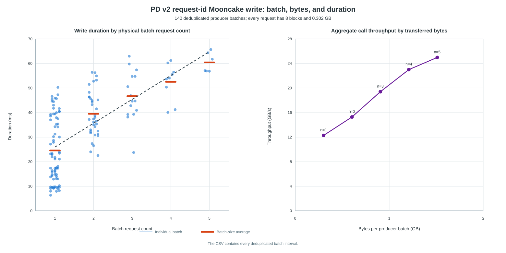

# PD v2 Mooncake Write Batch 与数据量关系分析（共享 Request ID）

> 数据来源：`docs/timing-pd-service-v2-256-request-id-shared-20261120.md` 第 8 节，底层使用 `analysis_reports/timing-pd-request-id-v2-256-20261120/filtered/prefill/1167100/timing.jsonl`。本文只分析 P 侧 Mooncake producer 的 `batch_transfer_sync_write()` 调用，不分析 D 侧 KV pull readiness，也不跨 P/D 进程相减时间戳。
>
> 报告状态：current-data analysis。本文已改为 2026-11-20 共享 `X-Request-Id` 的 V2 重测数据；当前数据有 140 个 KV send 物理 batch。旧 `syncStream-fixed` 数据中的 139 个 batch 分析不再作为当前 V2 口径。

## 1. 分析结论

1. 本轮 V2 数据中，`write, batch-weighted` 的 140 个物理传输 batch 来自 256 个 request。物理 batch 分布为 `1:75, 2:35, 3:15, 4:9, 5:6`。
2. 每个 request 固定传输 8 个 block、301,989,888 bytes，约 0.302 GB。因此 `batch_request_count`、`batch_block_count` 和 `batch_bytes` 完全线性等价：`batch_block_count = 8 * batch_request_count`，`batch_bytes = 301989888 * batch_request_count`。
3. 单次 write 耗时随 batch 数据量增加而增加，但不是线性翻倍。batch=1 平均 24.581 ms，batch=5 平均 60.440 ms；数据量变为 5 倍，平均耗时变为约 2.46 倍。
4. 单次调用的聚合吞吐随 batch 变大而提高：batch=1 为 12.286 GB/s，batch=5 为 24.982 GB/s。较大物理 batch 可以摊薄固定传输开销并提高传输并行度。
5. 耗时在 batch=4 后进入平台区间。batch=4/5 的平均耗时分别为 52.531/60.440 ms；batch=5 只有 6 个样本，其分位数只作本轮描述，不应外推为稳定分布。
6. 单次调用耗时方差较大。线性回归只能解释约 46.9% 的耗时差异，剩余差异主要来自并发传输重叠、Mooncake transport 内部调度和网络侧竞争。
7. 140 个 write interval 存在明显并发重叠：最大同时 9 个物理 batch 在传输；调用耗时总和为 4,762.031 ms，合并重叠后的 busy union 为 1,776.898 ms。
8. 共享 request id 后可以精确映射 P forward batch 与 KV send batch：本轮 140 个 KV send batch 全部只包含同一个 P forward batch 内的 request，没有跨 forward 合并；但 45 个 P forward 中只有 16 个保持为 1 个 KV send batch。

## 2. 与 Prefill forward batch 分布的关系

KV send 物理 batch 分布与 P 侧 prefill forward batch 分布不一致。

| 类型 | 物理批次总数 | batch 分布 | 主要形态 |
|---|---:|---|---|
| Prefill forward batch | 45 | `1:15, 3:1, 6:3, 7:3, 8:8, 9:15` | batch=8/9 |
| Mooncake KV send batch | 140 | `1:75, 2:35, 3:15, 4:9, 5:6` | batch=1/2/3 |

上表使用 batch-count 口径，即 `1:75` 表示 75 个 batch size 为 1 的物理 KV send batch。若按 request occurrence 口径，prefill forward 为 `1:15, 3:3, 6:18, 7:21, 8:64, 9:135`；Mooncake KV send 为 `1:75, 2:70, 3:45, 4:36, 5:30`。比较 batch 形态时应使用 batch-count 口径。

二者不是同一个批次的两个视角：

1. Prefill forward batch 由 P 侧 scheduler 在 StepThread 中形成，主要受 waiting queue、`max_num_batched_tokens=18432` 和 token budget 影响。
2. Mooncake KV send batch 由 sender executor 在 request KV ready 后形成，主要受 D metadata 分组、connector 队列、sender coroutine 调度、ready event 时序和远端 session 状态影响。
3. Forward 完成只是 KV cache 变为可发送的上游条件之一；KV send 的聚合边界发生在 connector/sender 侧，不继承 scheduler 的 forward batch 边界。

本轮共享 `X-Request-Id` 后，P finish、D finish、P `kv_send` 和 D `kv_receive` 使用同一组 request id，因此可以精确建立映射：

```text
P finish request ids
= D finish request ids
= P kv_send request ids
= D kv_receive request ids
= 256 个 request id

P/D/KV symmetric difference = 0
```

45 个 P forward batch 到 140 个 KV send batch 的拆分分布如下：

| 一个 P forward 拆成的 KV send batch 数 | P forward 数量 |
|---:|---:|
| 1 | 16 |
| 3 | 16 |
| 4 | 5 |
| 5 | 3 |
| 6 | 1 |
| 8 | 1 |
| 9 | 3 |

按 P forward size 拆分：

| P forward size | forward 次数 | 拆成 KV send batch 数分布 |
|---:|---:|---|
| 1 | 15 | `1:15` |
| 3 | 1 | `1:1` |
| 6 | 3 | `3:3` |
| 7 | 3 | `3:3` |
| 8 | 8 | `3:7, 4:1` |
| 9 | 15 | `3:3, 4:4, 5:3, 6:1, 8:1, 9:3` |

本轮 140 个 KV send batch 都只包含同一个 P forward batch 内的 request，没有跨 forward 合并。因此拆分主要发生在 forward 内部的 ready-request 子集上：batch=9 的 forward 通常没有等所有 request 一起 ready，而是按 ready 时序拆成多个更小的 KV send batch。

该结论是本轮时序观察，不是协议约束。Mooncake sender 代码边界仍允许一个 D metadata 混合不同 P forward 的 request；只是本轮 D metadata 分组与 P forward 分组没有产生跨 forward 合并。

## 3. Mooncake KV send batch 的组合过程

Mooncake KV send batch 的边界由 sender loop 中的 ready-request 子集决定，而不是由 P 侧 scheduler 的 forward batch 直接决定。核心调用链如下：

```text
D scheduler
    -> MooncakeConnectorScheduler.build_connector_meta()
    -> D receiver loop _start_load_kv()
    -> receive_kv_from_single_worker()
    -> ZMQ MooncakeXferMetadata 发给 P

P sender listener
    -> sender_worker_queue
    -> _sender_worker()
    -> send_kv_to_decode()
    -> 等待每个 request 的 SendBlockMeta.ready
    -> asyncio.wait(..., return_when=FIRST_COMPLETED)
    -> 取 done_tasks 中已经 ready 的 request
    -> _build_transfer_params(ready_reqs)
    -> _send_blocks()
    -> engine.batch_transfer_sync_write()
```

关键代码入口：

| 环节 | 代码位置 |
|---|---|
| sender worker / task 数量 | [mooncake_connector_worker.py](/workspace_v0.2.9/InfiniLM-v0.2.9/python/infinilm/kv_connector/mooncake/mooncake_connector_worker.py:150) |
| D metadata 进入 P 侧队列 | [mooncake_connector_worker.py](/workspace_v0.2.9/InfiniLM-v0.2.9/python/infinilm/kv_connector/mooncake/mooncake_connector_worker.py:368) |
| `_sender_worker()` 消费 metadata | [mooncake_connector_worker.py](/workspace_v0.2.9/InfiniLM-v0.2.9/python/infinilm/kv_connector/mooncake/mooncake_connector_worker.py:446) |
| `send_kv_to_decode()` 等待 ready request | [mooncake_connector_worker.py](/workspace_v0.2.9/InfiniLM-v0.2.9/python/infinilm/kv_connector/mooncake/mooncake_connector_worker.py:468) |
| `FIRST_COMPLETED` 聚合当前 done tasks | [mooncake_connector_worker.py](/workspace_v0.2.9/InfiniLM-v0.2.9/python/infinilm/kv_connector/mooncake/mooncake_connector_worker.py:506) |
| 提交 `_send_blocks()` 到 sender executor | [mooncake_connector_worker.py](/workspace_v0.2.9/InfiniLM-v0.2.9/python/infinilm/kv_connector/mooncake/mooncake_connector_worker.py:608) |
| 构造传输 pointer 和 `xfer_reqs_ids` | [mooncake_connector_worker.py](/workspace_v0.2.9/InfiniLM-v0.2.9/python/infinilm/kv_connector/mooncake/mooncake_connector_worker.py:670) |
| 调用 `batch_transfer_sync_write()` | [mooncake_connector_worker.py](/workspace_v0.2.9/InfiniLM-v0.2.9/python/infinilm/kv_connector/mooncake/mooncake_connector_worker.py:747) |
| 设置 P 侧 KV ready event | [mooncake_connector_worker.py](/workspace_v0.2.9/InfiniLM-v0.2.9/python/infinilm/kv_connector/mooncake/mooncake_connector_worker.py:1346) |
| D 侧构造 ZMQ metadata | [mooncake_connector_worker.py](/workspace_v0.2.9/InfiniLM-v0.2.9/python/infinilm/kv_connector/mooncake/mooncake_connector_worker.py:1050) |
| P scheduler 填入已完成 prefill 的 block ids | [mooncake_connector_scheduler.py](/workspace_v0.2.9/InfiniLM-v0.2.9/python/infinilm/kv_connector/mooncake/mooncake_connector_scheduler.py:168) |

### 3.1 D 侧先生成拉取 metadata

D scheduler 在 `MooncakeConnectorScheduler.build_connector_meta()` 中把当前需要远端 KV 的 request 放入 `reqs_to_recv`。D worker 的 `_start_load_kv()` 按 remote engine 分组后调用 `receive_kv_from_single_worker()`。

`receive_kv_from_single_worker()` 构造 `MooncakeXferMetadata`，包含 D request id、transfer id、D 侧目标 block ids 和 D 侧 KV cache base address，然后通过 ZMQ 发给 P。这个 metadata 的 request 集合来自 D scheduler 当前待拉取 KV 的 request，不等于 P 侧某个 prefill forward batch。

### 3.2 P 侧 sender loop 并发消费 metadata

本轮配置的 `kv_connector_extra_config` 只包含 `mooncake_protocol=rdma`，没有覆盖 `num_workers`，因此使用默认值：

```text
num_sender_workers = 10
num_sender_tasks = 2 * num_sender_workers = 20
```

`sender_worker_queue` 中的每个 D metadata 由一个 `_sender_worker()` coroutine 独立消费。真正的阻塞传输通过 `run_in_executor()` 提交到最多 10 个 sender executor 线程执行。20 个 coroutine 决定多少 metadata 可以同时推进，10 个线程决定多少 `batch_transfer_sync_write()` 可以同时阻塞执行。

### 3.3 KV ready event 决定本次可发送子集

P request 完成 prefill 后，scheduler 通过 `request_finished()` 填入实际 block ids；下一次 connector metadata 传到 worker 时，`record_send_reqs()` 设置：

```python
send_meta.local_block_ids = block_ids
send_meta.ready.set()
```

`send_kv_to_decode()` 为当前 D metadata 中的每个 request 创建 `wait_and_ret()` task，然后执行：

```python
done_tasks, pending_tasks = await asyncio.wait(
    wait_tasks,
    timeout=ABORT_REQUEST_TIMEOUT,
    return_when=asyncio.FIRST_COMPLETED,
)
```

`FIRST_COMPLETED` 表示至少一个 request ready 就进入发送分支，而不是等该 metadata 中所有 request ready。此时：

```text
done_tasks   -> 当前 ready_reqs，组成一个 KV send 物理 batch
pending_tasks -> 继续留在 while 循环，等后续 ready 后再组成后续 batch
```

因此，一个 D metadata 也可以被拆成多次 KV send。每次循环调用 `_build_transfer_params(ready_reqs, meta)`，只处理当前 ready request。

### 3.4 物理 KV send batch 的最终构成

`_build_transfer_params()` 遍历当前 `ready_reqs`，构造 src/dst pointer 和 length，并返回 `xfer_reqs_ids`。该列表长度就是 timing 里的 `kv_send.batch_request_count`。

准确地说：

```text
一个 KV send 物理 batch =
    同一个 D metadata 处理循环中的一批 done_tasks / ready_reqs
```

它不是一个 P prefill forward batch。

### 3.5 为什么一个 forward batch 可能被拆小

1. D metadata 边界与 P forward 边界不同。D 按自己 scheduler 当前积累的 `reqs_to_recv` 构造 metadata。
2. `FIRST_COMPLETED` 是低延迟策略，不是等满策略。部分 request ready 就先发送，其余 request 后续再发送。
3. ready event 的设置节奏可能跨越不同 scheduler step。
4. 20 个 `_sender_worker()` coroutine 可并发处理多个 D metadata。
5. 10 个 sender 线程允许多个较小 KV send batch 并发执行；本轮最大并发为 9。

本轮共享 request id 的精确映射进一步确认：所有 KV send batch 都没有跨 P forward 合并，拆分发生在 forward 内部 ready 子集上。

## 4. 统计口径

```text
write duration =
    batch_transfer_sync_write_completed_at_ns
  - batch_transfer_sync_write_started_at_ns

物理 batch =
    按 (pid, batch_id) 对 kv_send event 去重

单 batch 聚合吞吐 =
    sum(batch_bytes in batch-size group)
  / sum(write duration in batch-size group)
```

`batch_transfer_sync_write_started_at_ns` 和 `completed_at_ns` 包在 `engine.batch_transfer_sync_write()` 调用两侧，因此该耗时不包含 sender executor 排队时间；executor 排队更适合用 `kv_cache_send_ready_at_ns -> write start` 分析。由于多个 sender executor 调用可以重叠，单次 write duration 会受并发竞争影响。

## 5. Batch 与耗时分布

| batch request count | block count | bytes GB | count | avg ms | min ms | p50 ms | p95 ms | p99 ms | max ms | 聚合吞吐 GB/s |
|---:|---:|---:|---:|---:|---:|---:|---:|---:|---:|---:|
| 1 | 8 | 0.302 | 75 | 24.581 | 6.339 | 21.705 | 45.756 | 48.038 | 50.270 | 12.286 |
| 2 | 16 | 0.604 | 35 | 39.499 | 22.563 | 37.389 | 55.332 | 56.340 | 56.392 | 15.291 |
| 3 | 24 | 0.906 | 15 | 46.706 | 23.742 | 44.724 | 60.728 | 62.513 | 62.959 | 19.397 |
| 4 | 32 | 1.208 | 9 | 52.531 | 40.077 | 54.059 | 60.818 | 61.134 | 61.213 | 22.995 |
| 5 | 40 | 1.510 | 6 | 60.440 | 56.840 | 59.416 | 65.347 | 65.605 | 65.669 | 24.982 |
| All | - | - | 140 | 34.015 | 6.339 | 36.351 | 57.508 | 63.826 | 65.669 | 16.235 |

说明：

- `All` 行与当前 V2 主报告中的 `write, batch-weighted` 一致。
- `All` 行的 16.235 GB/s 是 `total bytes / sum(duration)`，表示把并发调用时间直接相加后的调用级吞吐，不等于链路物理带宽。
- batch=5 只有 6 个样本，其 p50/p95/p99 只作为本轮数据描述，不应作为稳定分位数结论。



左图展示每个物理 batch 的 write 耗时、batch-size 平均值和线性拟合；右图展示每个 batch-size 组的聚合吞吐。

## 6. 数据量与耗时的相关性

| 自变量 | Pearson r | Spearman r | 说明 |
|---|---:|---:|---|
| `batch_request_count` | 0.685022 | 0.681871 | 物理 batch 内 request 数 |
| `batch_block_count` | 0.685022 | 0.681871 | 等于 `8 * request_count` |
| `batch_bytes` | 0.685022 | 0.681871 | 等于 `0.302 GB * request_count` |

三个自变量的相关系数完全相同，不是因为传输耗时只由 request 数决定，而是因为本轮输入固定，三者完全共线。该数据无法区分“batch 内 request 数效应”和“纯 bytes 效应”。

线性拟合为：

```text
duration_ms = 16.269 + 9.704 * batch_request_count
R2 = 0.469
```

等价 bytes 口径约为 `32.135 ms / GB`。该模型只解释 46.9% 的单次耗时方差，只能作为粗略量级估计，不能外推远超 batch=5 的场景。

相邻 batch-size 的平均耗时增量为：

| 转移 | 数据量变化 | avg 增量 ms |
|---|---:|---:|
| 1 -> 2 | +0.302 GB | +14.918 |
| 2 -> 3 | +0.302 GB | +7.207 |
| 3 -> 4 | +0.302 GB | +5.825 |
| 4 -> 5 | +0.302 GB | +7.909 |

`1 -> 2` 到 `3 -> 4` 的边际增量明显下降，`4 -> 5` 有回升且样本量只有 6，不应过度解释。整体上，较大 batch 摊薄固定开销并提高聚合吞吐，但耗时逐渐进入约 52-66 ms 的区间。

## 7. 并发重叠的影响

| 指标 | 值 |
|---|---:|
| write 调用耗时总和 | 4,762.031 ms |
| 合并重叠后的 busy union | 1,776.898 ms |
| 最大并发物理 batch 数 | 9 |
| 平均并发度 | 2.680 |
| 总传输数据量 | 77,309,411,328 bytes |
| busy union 吞吐 | 43.508 GB/s |
| busy union 吞吐 | 348.065 Gbit/s |

按并发数量统计的 union 时间：

| 并发物理 batch 数 | union 时间 ms |
|---:|---:|
| 1 | 609.730 |
| 2 | 341.282 |
| 3 | 417.445 |
| 4 | 172.864 |
| 5 | 98.919 |
| 6 | 31.590 |
| 7 | 31.874 |
| 8 | 40.048 |
| 9 | 33.146 |

P 侧 write 不是严格串行执行。单次调用耗时既包含数据传输，也包含与其他并发调用共享 transport、NIC/网络路径和远端写入资源时的竞争。因此，不能把单个 batch 的 `bytes / duration` 直接当作链路带宽，也不能只用 bytes 解释单次耗时方差。评估整体传输能力时应使用 `total bytes / busy union`；评估调用延迟时应看 batch-weighted duration 分布。

## 8. 对 P 侧 batching 的解释

1. 合并 KV send batch 可以降低每个 request 的传输摊销时间。batch=1 时每 request 摊销 24.581 ms；batch=5 时降至约 12.088 ms。
2. 合并传输对降低 P 侧 KV write 调用摊销是正向的，但单次调用耗时仍从 batch=1 的 24.581 ms 增至 batch=5 的 60.440 ms。
3. 大 batch 会推迟同 batch 内所有 request 的 KV ready 时间，并可能放大 request-weighted KV readiness 与 TTFT 长尾。P 侧 batching 需要同时权衡物理 write 吞吐、同 batch 内 request 等待成本、D 侧 KV readiness 和 decode promotion 节奏。
4. 本轮输入长度固定，无法区分 request 数与 bytes 的独立效应。若要确认二者因果关系，需要补充不同 prompt 长度、不同 block 数但相同 batch request 数的对照实验。

## 9. 数据文件

```text
docs/timing-pd-service-v2-256-request-id-shared-20261120.md
analysis_reports/timing-pd-request-id-v2-256-20261120/filtered/prefill/1167100/timing.jsonl
docs/timing-pd-request-id-v2-256-20261120/timing-pd-v2-request-id-write-batches-20261120.csv
docs/timing-pd-request-id-v2-256-20261120/timing-pd-v2-request-id-write-relationship-20261120.svg
docs/timing-pd-request-id-v2-256-20261120/request-id-forward-kv-send-mapping-20261120.csv
docs/timing-pd-request-id-v2-256-20261120/forward-to-kv-send-mapping-20261120.csv
```

`timing-pd-v2-request-id-write-batches-20261120.csv` 中每个物理 batch 一行，包含 `batch_id`、request/block/bytes、write 起止时间戳、耗时和调用级吞吐。
